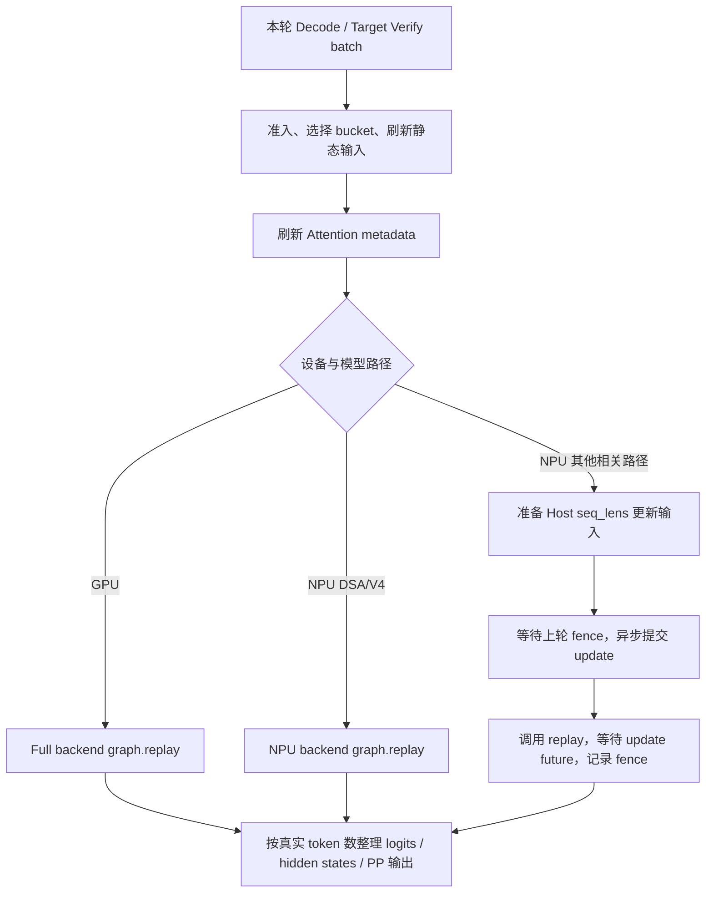

# GPU / NPU Decode Full 图与 MTP 图流程对比

日期：2026-10-10。分析时 HEAD：`259196360c4283eb8dd107ee6ccefc643c3afda6`。范围为当前仓库的 NVIDIA CUDA 与 Ascend NPU；MTP 重点分析 `eagle_worker_v2.py` 的 EAGLE-family 执行链。DFLASH、DSPARK、多层 MTP、adaptive spec 和模型专用实现需单独区分。

本文为静态源码分析，未运行 GPU/NPU 捕获或准确性测试。行号对应本次读取代码。文件索引中的路径均相对 `python/sglang/srt/`。

## 1. 结论与对象关系

| 层级 | GPU | NPU |
|---|---|---|
| 普通 Decode / target verify Runner | DecodeCudaGraphRunner | NPUGraphRunner，继承 DecodeCudaGraphRunner 并覆盖 execute 等逻辑 |
| Full 设备图后端 | FullCudaGraphBackend | NPUCudaGraphBackend |
| 图对象 | torch.cuda.CUDAGraph | torch.npu.NPUGraph |
| 输入刷新 | 静态 tensor 原地复制，Attention metadata 图外更新 | 同样刷新 tensor / metadata；部分路径额外重绑定 Host 序列长度属性 |
| 图更新 API | 正常 Full replay 不调用设备图 update API | 非 DSA/V4 的相关路径调用 NPUGraph.update(cpu_update_input=...) |
| MTP 稳态阶段 | draft → target verify → draft extend | 同样的阶段划分，draft/extend 使用 NPU 专用 Runner |

GPU 与 NPU 都是每个捕获 shape 保存图和输出。Full 不等于整个服务请求都在图内：调度、输入复制、元数据准备、验收处理等仍可能在图外。Decode Full 捕获的是模型 forward，通常包括 LM head / logits；这与 Prefill Full 的 body-only 捕获边界不同。

`resolve_decode_backend` 位于 `model_executor/runner_backend/utils.py:54`。NPU 返回 NPUCudaGraphBackend；GPU full 返回 FullCudaGraphBackend。NPU 此处仅接入 Full-style 后端，但上层关闭 Decode graph 时不会因为该分支而重新启用图。

## 2. Decode Full：捕获参数区别

### 2.1 共同的捕获组织

DecodeCudaGraphRunner 初始化时确定 capture_bs、capture_forward_mode、captured_req_width、hidden mode、attention state 和静态 buffers。

- 普通 decode：capture_forward_mode=DECODE，通常每请求一个 token。
- 推测解码 target：capture_forward_mode=TARGET_VERIFY，每请求宽度由算法决定。
- 均使用 bucket 的固定 buffer view；请求不足 bucket 时补齐。
- capture_one_shape 先初始化图外 Attention metadata；run_once 中执行图内 metadata hook 和模型 forward。
- GPU/NPU 后端均执行两次普通 warmup，再正式录制。

关键位置：`model_executor/runner/decode_cuda_graph_runner.py:302` 附近的模式与宽度设置；`capture_prepare:896`；`capture_one_shape:1174`；图外 metadata:1204；图内 hook:1211。

### 2.2 设备图捕获接口

| 参数/行为 | GPU Full | NPU Full |
|---|---|---|
| 图对象 | torch.cuda.CUDAGraph() | torch.npu.NPUGraph() |
| 捕获上下文 | device_module.graph(cuda_graph=graph, pool=..., stream=...) | torch.npu.graph(graph, pool=..., stream=..., auto_dispatch_capture=True) |
| pool 来源 | get_or_create_global_graph_memory_pool，公共资源中的 pool | 后端首次 capture_session 自行创建 graph_pool_handle |
| 捕获 stream | Runner 提供；公共 GPU 捕获路径支持复用全局 capture stream | 同样由 Runner/session 传入，需按 NPU 的图捕获上下文处理 |
| CUDA pool scope | capture/replay 均进入公共 graph pool scope | 此后端未包对应 scope |
| pool precarve | GraphPoolPrecarve 测量/预分配 | 无对应操作 |
| torch.compile guard | Full 后端此处无 NPU 同款 stance 包装 | enable_torch_compile 时使用 skip_guard_eval_unsafe=True |
| 输出保存 | 保存捕获输出；可选共享输出功能主要服务 Prefill，Decode 默认未开启 | 保存捕获输出 |
| cache location | GPU Runner 默认 int64 | NPU override int32 |

源码：GPU `runner_backend/full_cuda_graph_backend.py:106,116`；NPU `hardware_backend/npu/graph_runner/npu_cudagraph_backend.py:79,89`；NPU dtype `npu_graph_runner.py:207`。

`auto_dispatch_capture=True` 是 NPU 捕获接口的显式差异；其内部调度语义由 torch_npu 版本决定，不能仅凭这个参数推导全部算子都可捕获。

## 3. Decode Full：更新图区别

### 3.1 GPU：更新固定地址中的数据

```text
真实 batch
  → load_batch：选择 bucket，更新 input_ids / positions / seq_lens / cache loc 等
  → init_forward_metadata_out_graph：更新 Attention plan / 静态 metadata
  → FullCudaGraphBackend.replay
  → CUDAGraph.replay
```

GPU 的核心契约是图读取已刷新、地址稳定的 tensor / backend 状态。不同 Attention backend 的 plan、metadata 更新内容不同，不能笼统称为全部在图内或全部重新分配。

正常 Full replay 没有调用 cudaGraphExecUpdate 去修改模型图。其他模块的 CUDA 图去重优化不等于此处每轮请求的 Full 更新机制。

源码：`decode_cuda_graph_runner.py:1307` load_batch、`:1503` metadata 初始化、`:1526` execute、`:1556` replay；`full_cuda_graph_backend.py:204` replay。

### 3.2 NPU：tensor 刷新 + 可选 Host 输入重绑定

NPU 同样需要刷新静态输入和 metadata，但部分 Attention 序列长度以 Host 侧属性传入，额外执行：

```python
graph.update(cpu_update_input=[{attr_name: seq_lens}])
```

这不是重新录制模型图，也不是更新模型权重，而是给捕获图更新相应输入属性绑定。

当前 `NPUGraphRunner.execute` 对 DeepSeek DSA / DeepSeek-V4 直接 replay；其他相关路径走 replay_with_input_update。不能概括为所有 NPU 图每轮都必须 update。

#### 更新属性与长度

`npu_graph_runner.py:139` 的映射包括：

| 属性键 | 对应场景/映射 |
|---|---|
| actual_seq_lengths_kv | MLA 映射及普通默认更新选择 |
| context_lens | 非 DLLM MHA 的映射项 |
| actual_seq_kvlen | TARGET_VERIFY / V2 更新选择 |

实际选择必须看 `_get_update_attr_name:189` 和 `_uses_v2_seq_len_update:163`，不能只根据 MHA/MLA 映射表推导。当前普通默认 getter 返回 MLA 对应键；V2/FIA 等条件选择 TARGET_VERIFY 键。不同算子接口可能使用 Python list 或 CPU tensor，必须与捕获时类型一致。

长度准备位于 `npu_graph_runner.py:375` 附近：

- 普通 decode 使用本轮 seq_lens，并补 bucket 空槽。
- target verify 通常需要包含验证 token 宽度的有效 KV 长度。
- DFlash 优先使用 backend 已计算的 seq_lens_cpu_list，避免重复增加 draft block。
- DSA/V4 跳过这条 Host update 路径。

### 3.3 NPU 更新与 replay 的真实提交顺序

`NPUCudaGraphBackend.replay_with_input_update` 位于 `npu_cudagraph_backend.py:156`：

```python
if self._rebind_fence is not None:
    self._rebind_fence.synchronize()

update_future = self._update_executor.submit(
    graph.update, cpu_update_input=cpu_update_input
)
graph.replay()
update_future.result()

fence = self._device_module.Event()
fence.record()
self._rebind_fence = fence
```

顺序为“等待上一轮 fence → 工作线程提交 update → 主线程调用 replay → 等待 update future → 记录本轮 fence”。工作线程绑定当前 NPU device，且只配置一个 worker。

注意：Python 代码不是先 future.result 再 replay；因此不能把它解释成 Python 层已经显式保证 update 完成后才调用 replay。更新与设备消费之间的正确顺序依赖 torch_npu 的底层契约，应在目标版本实机确认。此处只是标明验证边界，不据此断言存在竞态。

上一轮 fence 的作用是避免上一轮仍在读取 Host 序列长度绑定时就进行下一次重绑定。

## 4. Decode Full：执行过程区别



GPU execute 有公共 metadata/shared-read 同步、图 key 选择和输出处理；NPU 覆盖 execute，含 NPU 特有长度更新和 DFlash/DP 等分支，因此不只是替换底层图类。

值得补充审查的差异：

- GPU replay 使用 load_batch 设置的 `_replay_graph_key`；NPU execute 在该路径使用 `_make_graph_key(self.bs)`，新增 attention/LoRA/stream variant 时需要确认键是否完整携带。
- GPU PP 输出处理明确考虑 `bs * captured_req_width`；NPU 输出分支需按当前模型/PP 支持范围核对，不能假设与 GPU 所有输出字段和裁剪规则完全等价。
- GPU 与 NPU 不同后端的 metadata、padding 哨兵、cache location dtype 不同；图 API 相同形式不代表输入协议相同。

## 5. MTP：到底捕获几类图

### 5.1 先区分阶段数、图族数和图对象数

MTP 这里按当前 EAGLE-family worker 分析，不等于所有推测算法共用一套流程。

常见稳态 decode 有三类图族：

1. draft decode 图：draft 模型生成后续候选。
2. target verify 图：target 模型并行验证候选。
3. draft extend-for-decode 图：根据验收结果补齐 draft KV / 状态，准备下一轮。

prefill 后的 draft extend 是第四种逻辑阶段，但不是必然独立的第四套 Decode Full 图。它走 draft_runner.forward，是否命中独立 Prefill 图由 Prefill Runner、模型及请求准入决定。

每类图族又按 batch buckets 和变体捕获多张图，所以不能回答为固定“3 张”或“4 张”。

### 5.2 各阶段对照

| 阶段 | 模型 | GPU 入口 | NPU 入口 | 输入宽度 / 作用 |
|---|---|---|---|---|
| Draft decode | draft / MTP 模型 | EAGLEDraftCudaGraphRunner | EAGLEDraftNpuGraphRunner | 每步 B×topk；图内包含多步 draft_forward 和候选处理 |
| Target verify | target 模型 | DecodeCudaGraphRunner，TARGET_VERIFY | NPUGraphRunner，TARGET_VERIFY | 常规 EAGLE 宽度由 num_draft_tokens 决定；算法 hook 可不同 |
| Draft extend for decode | draft / MTP 模型 | EAGLEDraftExtendCudaGraphRunner | EAGLEDraftExtendNpuGraphRunner | DRAFT_EXTEND_V2；B×num_draft_tokens 静态布局，消费验收相关输入 |
| Draft extend for prefill | draft / MTP 模型 | _draft_extend_for_prefill → draft_runner.forward | 共用 worker 流程，具体执行受设备路径限制 | 处理 prompt 新 token，输入 target hidden states，补齐 draft KV；不直接调用上述 decode-extend 图 |

宽度统一定义见 `speculative/spec_utils.py:96`：draft_decode=speculative_eagle_topk；draft_extend=speculative_num_draft_tokens；target_verify 经算法 hook 派生。

### 5.3 Draft 图不是每个 speculative step 一张图

`eagle_draft_cuda_graph_runner.py:505` 的捕获函数调用 `eagle_worker.draft_forward(forward_batch)`，再在第 537 行调用 backend.capture_one。

`eagle_worker_v2.py:756` 遍历 speculative_num_steps，第 767 行在最后一次候选整理时 break，不执行最后一次模型 forward。因此常规路径一轮包含 S−1 次 draft 模型 forward；这些调用可一起被录入当前 bucket 的一张 draft 图，而不是 S−1 张独立图。

worker 第 471 行仅当 speculative_num_steps>1 时创建 draft decode 图。S=1 时这一图族可以不存在；不能假设总有三类图。

### 5.4 Target verify 图与普通 Decode 图不同

DecodeCudaGraphRunner 在推测模式下把捕获模式设为 TARGET_VERIFY，并使用算法派生的 captured_req_width：

```text
普通 decode：B 个请求 → 通常 B 个 token
target verify：B 个请求 → 通常 B×D 个验证 token
```

verify 使用候选位置、tree/mask、hidden-state 捕获等额外信息，并不是把普通 B-token decode 图 replay D 次。

验收与采样不应默认全算进模型 Full 图；其边界需看 worker 的 verify 和后处理代码。Full 的范围是所传捕获 callable，不是整个 MTP 轮次。

### 5.5 Draft extend for decode 与 for prefill 不同

`_draft_extend_for_decode` 位于 `eagle_worker_v2.py:1048`，第 1121 行附近检查专用图准入，第 1145 行调用 `cuda_graph_runner_for_draft_extend.execute(...)`。静态宽度是完整 num_draft_tokens，不能简单替换为 num_steps+1，尤其 topk>1 时二者不同。

`_draft_extend_for_prefill` 位于第 904 行：按请求旋转 input_ids、构建 EagleDraftExtendInput，num_tokens_per_req=1，输入 target hidden states，最后调用 draft_runner.forward（第 1005 行）。该 spec 字段不表示整个 prompt 只有 B 个 token；实际 extend 输入仍包含 prompt 的新 token 布局。

GPU/NPU 的 draft extend 图创建还有条件：draft_extend_attn_backend 存在、未设置 SGLANG_DISABLE_DRAFT_EXTEND_CUDA_GRAPH、设备/backend 受支持。位置 `eagle_worker_v2.py:565`。GPU 需要通过 backend 类型筛选；NPU 有自己的放行分支，但请求仍需 can_run_graph。

### 5.6 NPU MTP 各图的更新区别

| 图族 | NPU 更新策略 |
|---|---|
| Draft decode | 非 DSA/V4 时生成每个内部 draft forward 的 seq_lens 更新项，一次传入多个 cpu_update_input dict；长度为本轮长度 + step + 1 |
| Target verify | NPUGraphRunner 按 verify 的有效 KV 长度更新；注意 V2 键名、DFlash 特例 |
| Draft extend for decode | 非 DSA/V4 时使用本轮 seq_lens 更新 actual_seq_lengths_kv |
| DSA/V4 的上述对应路径 | 代码分支直接 replay，不走此 Host update API |

源码：`hardware_backend/npu/graph_runner/eagle_draft_npu_graph_runner.py:90`；`eagle_draft_extend_npu_graph_runner.py:37`；`npu_graph_runner.py:375`。

多个 update dict 表示图内多个 draft forward 的更新输入，不表示对应多张图。

### 5.7 数量计算示例

假设三个图族均启用，每族捕获 buckets=[1,2,4,8]，无变体、无 adaptive 配置、单捕获 stream：

```text
Draft decode         4 张
Target verify        4 张
Draft extend decode  4 张
合计                 12 张设备图
```

再独立计算 target/draft Prefill 图。实际数量还受 greedy/采样变体、attention 变体、LoRA 变体、stream、多层 MTP 和 adaptive spec 候选配置影响。应统计实际 backend._graphs 中的 shape_key，而不是根据阶段名称猜数量。

## 6. “静态 kernel”开启参数：需要区分含义

当前代码未找到一个统一名为 static-kernel 的 Decode Full 开关。以下配置对应不同概念，不能相互替代。

| 所指含义 | 参数/代码 | 说明 |
|---|---|---|
| 开启 Decode Full 图 | --cuda-graph-backend-decode full | 当前 GPU Decode 初始 backend 已是 full；NPU 走 Full-style 设备后端。上层禁用和准入仍有效 |
| 设置捕获 batch 形状 | --cuda-graph-bs-decode / --cuda-graph-max-bs-decode | 固定捕获的 B buckets，不是指定某种 kernel |
| 额外 torch.compile 优化 | --enable-torch-compile，--torch-compile-max-bs | 独立编译开关，不是 Full 图必要条件，也不是所有算子的静态化开关 |
| GPU Triton decode Attention 固定 KV splits | SGLANG_TRITON_DECODE_ATTN_STATIC_KV_SPLITS=1 | 具体算子配置，默认 False；固定为 max_kv_splits，不等于开启 Full 图 |
| NPU 关闭算子 JIT 编译模式 | torch_npu.npu.set_compile_mode(jit_compile=False) | NPU 初始化已执行，不是用户额外开启 Decode Full 的 CLI；也不能直接称为所有 kernel 均采用静态 shape |
| 显存比例 | --mem-fraction-static | 内存预算参数，与“静态 kernel”无关 |

Triton static splits：`layers/attention/triton_backend.py:314` 读取；第 437 行附近在相应条件下填充 max_kv_splits。确定性模式和其他 backend 分支会影响该策略，不能用于描述所有 GPU Attention。

环境变量声明：`environ.py:1138`。NPU compile mode 设置：`hardware_backend/npu/utils.py:221`。图与编译 CLI 字段：`arg_groups/fields/exec_.py:510,535,590`。

如果“静态 kernel”特指 Ascend 某个 Attention/Matmul 接口或底层运行时能力，需要补充算子名、日志或原参数，才能给出唯一对应开关。当前仓库的图后端没有据此设置一个通用静态 kernel 参数。

## 7. 补充风险与验证建议

| 关注点 | 应验证什么 |
|---|---|
| 长度更新准确性 | 同一 B 下上下文逐步增长，verify 是否正确包含 draft 宽度；DFlash 不重复增加 |
| 异步 update 顺序 | 目标 torch_npu 版本中 update/replay 的契约，快速连续 replay 是否读取最新 Host 长度 |
| bucket 切换 | B 小→大→小，空槽哨兵、cache loc、positions 和 hidden states 是否清理正确 |
| MTP 宽度 | topk>1、S 与 D 不相等时 buffers 不越界、图准入正确 |
| 图 key 变体 | Attention/LoRA/采样/stream/adaptive 配置是否选择正确图 |
| 输出完整性 | logits、hidden states、PP 输出及扩展字段是否在设备 override 中保留 |
| 多卡一致性 | 所有 rank 对图/eager、bucket 和阶段切换保持一致，避免通信次序不一致 |
| 性能与显存 | 图数量、pool 共享、Host update、fence 同步成本；Full 不保证所有场景更快 |

## 8. 阅读顺序与源码索引

| 文件 | 关键符号 / 行号 |
|---|---|
| model_executor/runner_backend/utils.py | resolve_decode_backend:54 |
| model_executor/runner/decode_cuda_graph_runner.py | 模式/宽度:302；capture_prepare:896；capture_one_shape:1174；load_batch:1307；execute:1526 |
| model_executor/runner_backend/full_cuda_graph_backend.py | capture_session:106；capture_one:116；replay:204 |
| hardware_backend/npu/graph_runner/npu_graph_runner.py | 初始化:100；属性映射:139；V2判断:163；getter:189；execute:238；更新分支:375 |
| hardware_backend/npu/graph_runner/npu_cudagraph_backend.py | capture_session:79；capture_one:89；replay:147；replay_with_input_update:156 |
| speculative/eagle_worker_v2.py | 图创建:451；draft_forward:690；draft_extend_for_prefill:904；draft_extend_for_decode:1048 |
| speculative/eagle_draft_cuda_graph_runner.py | 模式/宽度:152；capture_one_shape:371；draft_forward调用:505；backend.capture_one:537 |
| speculative/eagle_draft_extend_cuda_graph_runner.py | DRAFT_EXTEND_V2:113；宽度:153；capture_one_shape:349；backend.capture_one:508；execute:515 |
| hardware_backend/npu/graph_runner/eagle_draft_npu_graph_runner.py | _replay_graph:90 |
| hardware_backend/npu/graph_runner/eagle_draft_extend_npu_graph_runner.py | _replay_graph:37 |
| speculative/spec_utils.py | resolve_num_tokens_per_req:96 |
| layers/attention/triton_backend.py | static_kv_splits读取:314；固定split分支:437 |
| hardware_backend/npu/utils.py | set_compile_mode:221 |

最终判断应以具体模型、Attention backend、spec 算法和实际解析配置为准。本文的共同流程不代表所有这些组合都已实机验证。
