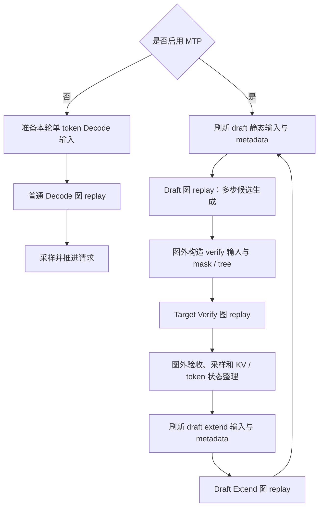

# Decode Full：普通 Decode 与 MTP 三类图的捕获和数据更新对比

日期：2026-10-10。分析时 HEAD：`2a91c048210577c792cf09a13e40dc4c18f5042d`。

范围：当前 NVIDIA CUDA / Ascend NPU 的 Full 图后端，以及 `eagle_worker_v2.py` 的 EAGLE-family MTP 路径。“补图”按捕获图解释；文末单独说明重捕获。DFLASH、DSPARK、Frozen-KV、多层 MTP、adaptive spec 及特定模型分支不应直接套用全部结论。

本文为静态源码分析，未运行 GPU/NPU 捕获、准确性或性能测试。文件索引路径位于 `python/sglang/srt/`，行号按本次读取代码。

## 1. 总体结论

普通 Decode 的一张 bucket 图，主要录制 target 模型的一次单 token-per-request forward；MTP 将稳态执行分成 draft、target verify、draft extend-for-decode 三类图族。

三个阶段各有自己的捕获 callable、静态输入、Attention 元数据和输出语义，不能简单当成普通 Decode 图换一组 input_ids。

GPU/NPU 共享多数阶段 Runner 和数据准备逻辑；NPU 更换设备图后端，并针对部分非 DSA/V4 Attention 路径额外调用 `NPUGraph.update(cpu_update_input=...)` 重绑定 Host 长度属性。DSA/V4 的对应分支直接 replay，不表示它们不更新长度或其他输入。

## 2. 四类图的核心区别

记 B 为捕获 batch bucket、K 为 speculative_eagle_topk、S 为 speculative_num_steps、D 为 speculative_num_draft_tokens。下面的宽度描述针对通常的 uniform EAGLE 布局；target verify 的最终宽度以算法 hook 为准。

| 项目 | 普通 Decode | MTP Draft | MTP Target Verify | MTP Draft Extend for Decode |
|---|---|---|---|---|
| 执行模型 | target 模型 | draft / MTP 模型 | target 模型 | draft / MTP 模型 |
| 捕获模式 | DECODE | DECODE，多步 draft 调用 | TARGET_VERIFY | DRAFT_EXTEND_V2 |
| 静态 token 布局 | 通常 B×1 | 每个内部 forward 通常 B×K | 常规 EAGLE 通常 B×D | B×D；不能用 S+1 替代 D |
| 捕获 callable | 一次模型 forward + metadata hook / tail hooks | 整个 draft_forward，包含多步 forward 与候选处理 | 一次 target 验证 forward + metadata hook / tail hooks | 一次 draft extend 模型 forward + metadata hook |
| 特殊输入 | 无 MTP spec 输入 | topk_p、topk_index、target/draft hidden states、各步 KV 写入位置、可选 DSA seed | 候选 token、positions、tree/mask 等验证信息 | target hidden states、验收相关 token/长度、select_index |
| 输出 | logits，按模型配置还可返回 hidden states | parents、候选 token/索引、可选 proposal 概率等 | 候选位置 logits、所需 target hidden states | 用于下一轮 draft 的 logits / hidden states |
| 后续用途 | 采样下一个 token | 构造验证输入 | 图外采样、验收和状态整理 | 补齐 draft KV / 状态，建立下一轮 draft 起点 |
| 主要 Runner | DecodeCudaGraphRunner / NPUGraphRunner | EAGLEDraftCudaGraphRunner / EAGLEDraftNpuGraphRunner | DecodeCudaGraphRunner / NPUGraphRunner | EAGLEDraftExtendCudaGraphRunner / EAGLEDraftExtendNpuGraphRunner |

以上四列中的 Full 都是所选 callable 的设备图捕获，不表示调度、全部验收逻辑、KV 分配和整个 MTP 轮次都入图。普通 CausalLM 的 forward 通常含 LM head / logits；特殊模型仍以其真实 forward 为准。

宽度定义：`speculative/spec_utils.py:96`，draft_decode=K，draft_extend=D，target_verify 通过算法 hook 派生。

### 2.1 不是固定三张图

MTP 通常有三类稳态图族，每类按 B buckets 捕获多张图。S>1 才创建常规 draft decode 图；draft extend 图还受 backend 和禁用开关约束。

例如三个图族均启用，B buckets=[1,2,4,8]，无其他变体时有 12 张设备图。sampling/attention/LoRA/stream 变体及 adaptive 配置可能增加数量。

Draft 一张图中可以录入 S−1 次模型 forward；不是 S−1 张图。`draft_forward` 在最后一次循环仅整理候选，不再做一次模型 forward。见 `eagle_worker_v2.py:756,767`。

## 3. 普通 Decode 与 MTP 的执行关系



Prefill 后的 `_draft_extend_for_prefill` 是另一逻辑阶段：它走 draft_runner.forward，是否使用 Prefill 图需单独判断，不能把这里的 DRAFT_EXTEND_V2 图直接当作 prompt extend 图。

## 4. 捕获时机与共同后端差异

### 4.1 启动调用链

```text
Scheduler.init_model_worker
  → 初始化 target / draft 模型
  → init_memory_pools
  → init_all_attention_backends
  → init_all_cuda_graphs
      → target ModelRunner.init_cuda_graphs
          → capture_cuda_graphs
          → capture_decode_graph：普通 Decode 或 TARGET_VERIFY
      → draft worker.init_cuda_graphs
          → 不再重复建立普通 draft Decode Runner
          → _capture_cuda_graphs：专用 draft / draft extend 图
```

正常启动使用 `ModelRunner.init_cuda_graphs:1109`，不是必须直接调用 `init_decode_cuda_graph:1533`。后者用于单独补捕/重捕等路径。

Draft worker 在 `eagle_worker_v2.py:268` 用 capture_decode_cuda_graph=False 初始化公共图资源，再在 `_capture_cuda_graphs:451` 创建专用图。第 471 行 S>1 创建 draft；第 565 行附近按 backend/开关条件创建 draft extend。

### 4.2 GPU / NPU Full 捕获参数

| 内容 | GPU | NPU |
|---|---|---|
| 设备图 | torch.cuda.CUDAGraph | torch.npu.NPUGraph |
| 捕获接口 | device_module.graph(cuda_graph=graph, pool=..., stream=...) | torch.npu.graph(graph, pool=..., stream=..., auto_dispatch_capture=True) |
| warmup | 两次普通 callable 执行，含同步/barrier及可选清理 hook | 同样两次 |
| pool | 获取公共共享 graph pool | NPU 后端自行持有首次创建的 pool handle |
| CUDA pool scope / precarve | 有公共 capture/replay scope 和内存测量预分配 | 此后端没有同款 scope / precarve |
| compile guard | Full 后端没有 NPU 同款 stance 包装 | enable_torch_compile 时使用 skip_guard_eval_unsafe=True |
| out_cache_loc dtype | 默认 int64 | 专用 Runner override 为 int32 |
| 输出保存 | 按 shape_key 保存捕获输出 | 同样按 shape_key 保存捕获输出 |

源码：`runner_backend/full_cuda_graph_backend.py:106,116,204`；`hardware_backend/npu/graph_runner/npu_cudagraph_backend.py:79,89,147`。

这张表同时适用于通过该 Full 后端捕获的普通 Decode、target verify、draft 和 draft extend；阶段差异主要在传入后端的 callable 与输入协议。

## 5. Draft 图：捕获与更新

### 5.1 捕获范围

`EAGLEDraftCudaGraphRunner.capture_one_shape:371` 创建 B×K 布局、各步 out_cache_loc、hidden states、topk_p/index 等输入。

第 489 行附近定义 run_once：

```python
self.draft_attn_backend.init_forward_metadata_in_graph(forward_batch)
...
ret = self.eagle_worker.draft_forward(forward_batch)  # 第505行
...
# 恢复被 Python forward 修改的字段和 positions，供后续预热/捕获复用
return ret
```

第 514 行在捕获外初始化多步 Attention metadata，第 537 行 backend.capture_one 录制整个 run_once。开启 rejection sampling 时还可能捕获普通/greedy 两种变体。

### 5.2 每轮数据刷新：GPU/NPU 共用部分

`execute:553` 执行：

- 选择 B bucket，清理 padding 的 seq_lens、cache loc、positions、候选输入、hidden states 和可选 DSA seed。
- 原地复制 seq_lens、各步 out_cache_loc、positions、topk_p、topk_index、req_pool_indices。
- 按需要复制 mRoPE、hidden states、DSA seed 等字段；大 hidden states 使用单独 copy_。
- 更新 CPU 长度副本和 DP token 数据。
- 第 717 行图外初始化多步 Attention metadata。
- 第 728 行调用 `_replay_graph`。

GPU `_replay_graph:302` 调用 backend.replay。这里的“更新”是固定地址数据和 metadata 更新，不是修改模型图结构。

### 5.3 NPU 特有更新

NPU 继承上述 execute，覆盖 `_replay_graph`，见 `eagle_draft_npu_graph_runner.py:90`：

```python
if not (is_deepseek_dsa(hf_config) or is_deepseek_v4(hf_config)):
    for step in range(self.speculative_num_steps - 1):
        seq_lens = (forward_batch.seq_lens_cpu[:raw_bs] + step + 1).tolist()
        seq_lens += [0] * (bs - raw_bs)
        # 每个内部 forward 一个 Host 长度更新项
    backend.replay_with_input_update(..., cpu_update_input=更新项列表)
else:
    backend.replay(...)
```

例如 S=3、本轮长度[100,200]，一张 draft 图包含两次模型 forward，对应更新项为[101,201]和[102,202]。两个更新项不等于两张图。

## 6. Target Verify 图：捕获与更新

### 6.1 与普通 Decode 的捕获差异

两者使用相同 Decode Runner 框架，但推测模式将 capture_forward_mode 设为 TARGET_VERIFY，并按算法宽度录制 B×D 输入。

`decode_cuda_graph_runner.py:1174` 的 capture_one_shape：第 1204 行初始化图外 metadata；第 1211 行把可捕获 metadata hook 放进 run_once；随后调用模型 forward 和 capture_tail_hooks。

verify 图一次处理多个候选位置，包含对应 mask/tree/positions 协议；不是普通 B-token Decode 图重复 replay D 次。target hidden-state 输出需求也与普通 decode 不同。

### 6.2 run_eagle_verify 如何进入图

```text
EagleWorker.verify
  → run_eagle_verify                         eagle_worker_common.py:565
  → eagle_prepare_for_verify                准备候选、图准入与可选预先load_batch
  → target_worker.forward_batch_generation  eagle_worker_common.py:672
  → model_runner.forward
  → _forward_raw                            model_runner.py:1884
  → can_run_graph                           model_runner.py:1901
  → decode_cuda_graph_runner.execute        model_runner.py:1917
```

TARGET_VERIFY 被 `forward_batch_info.py:272` 的 is_cuda_graph 明确允许。模型 forward 返回后，run_eagle_verify 才继续采样/验收；不能把整个 run_eagle_verify 都视为图内执行。

### 6.3 GPU 更新

Decode Runner `load_batch:1307` 更新候选 input_ids、positions、seq_lens、req indices、cache loc 及相关 spec 输入；第 1420 行通过 registry.fill_from 原地刷新公共输入。

第 1503 行附近刷新图外 Attention metadata；随后 execute 使用正确 shape_key replay。若 verify 准备阶段已完成 load_batch，则复用预先准备的静态输入/metadata，不重复全部准备。

### 6.4 NPU 更新

NPU target 使用 `NPUGraphRunner.execute:238`，在公共 load_batch 外有专门处理。非 DSA/V4 分支还准备 Host KV 长度并调用 replay_with_input_update：

- 常规 verify：KV 长度通常增加 captured_req_width。
- V2 接口按 getter 选择 actual_seq_kvlen；其他相关接口通常 actual_seq_lengths_kv。
- DFlash 优先使用 metadata 已计算的有效长度，避免重复增加 draft block。
- DSA/V4 直接 backend.replay，但设备 metadata 仍已刷新。

源码：`npu_graph_runner.py:139,163,189,375`。属性映射中存在 context_lens，不代表 execute 的 getter 会根据 MHA 自动选择它；应以真实 getter 为准。

## 7. Draft Extend for Decode 图：捕获与更新

### 7.1 捕获范围

`EAGLEDraftExtendCudaGraphRunner` 第 113 行设置 DRAFT_EXTEND_V2，第 153 行设置 captured_req_width=D。

`capture_one_shape:349` 使用 B×D token 布局，并准备 select_index、验收相关输入、hidden states 等；第 457 行 run_once 调用图内 metadata hook，第 471 行附近调用 draft model.forward。第 486 行图外 metadata 初始化，第 508 行 backend.capture_one。

这是根据 target 验证结果维护 draft 模型的计算，不能直接替代 target verify 图，也不能等同 prompt 的 draft_extend_for_prefill。

### 7.2 每轮数据刷新：GPU/NPU 共用部分

`execute:515`：

- 选择 B bucket；padding 时初始化 seq_lens、cache loc、positions、req indices、num_correct_drafts、num_accept_tokens、extend_seq_lens。
- 原地复制 input_ids、seq_lens、out_cache_loc、positions、req indices。
- 更新 extend_seq_lens、验收计数、select_index（第 581 行），以及可选 mRoPE/Mamba 状态索引。
- 单独复制 target hidden states（第 602 行附近）。
- 刷新 CPU 长度、spec extend 长度与 DP 数据。
- 第 659 行图外初始化 draft extend Attention metadata。
- 第 674 行 `_replay_graph`，再按真实请求整理输出。

select_index 表示本轮需要选取的输出位置；验收计数和 hidden states 是该图与普通 Decode 图的重要差异。

### 7.3 NPU 特有更新

NPU 继承公共 execute，在 `eagle_draft_extend_npu_graph_runner.py:37` 覆盖 replay：

```python
if not (is_deepseek_dsa(hf_config) or is_deepseek_v4(hf_config)):
    seq_lens = forward_batch.seq_lens_cpu.tolist() + padding_zeros
    return backend.replay_with_input_update(
        shape_key,
        seq_lens=seq_lens,
        attr_name="actual_seq_lengths_kv",
        attr_type=[],
    )
return backend.replay(shape_key, forward_batch)
```

此处不像 draft decode 那样生成 S−1 组逐步增长长度，而是为一次 draft extend forward 提供本轮长度。长度的阶段语义由前面的 draft extend 输入准备决定。

## 8. 为什么 DSA 不需要 Host update，但仍必须更新设备长度

普通 MLA 与 DSA 都从 metadata 获取长度。区别是最终算子参数：

| 路径 | 最终长度参数 | 每轮刷新方式 |
|---|---|---|
| 非 DSA 普通 MLA 的 FIA 图路径 | metadata 长度转换/选择为 Python list，传 actual_seq_lengths_kv | 静态输入/metadata 刷新之外，Host graph.update |
| DSA sparse Attention 图路径 | metadata 的设备 tensor，传入时为 NPU int32 tensor | 固定地址 copy_ 与图内相关计算，不走该 Host list update |

DSA 相关证据：

- `ascend_backend.py:845`：捕获 metadata.seq_lens=seq_lens，绑定静态 buffer。
- `:1031`：按 target verify 或 draft step 修正长度。
- `:1047`：metadata.seq_lens[:bs].copy_(seq_lens[:bs])，原地更新。
- `:1402`：forward_sparse 选择实际 KV 长度 tensor。
- `:1482`：以 device tensor 传给 npu_sparse_flash_attention。

非 DSA MLA 示例：`:2912` 从 metadata 取长度/转 list，`:2951` 传给 FIA。Python list 原地修改不保证刷新捕获图内部已转换的参数，所以使用显式 graph.update。

DSA 的 DCP、KV offload、spec step 可能选择其他专用长度 tensor；V4 有独立 backend，不能用上述 DSA 单一路径替代它的全部分析。

## 9. NPU update 与 replay 的线程顺序

`npu_cudagraph_backend.py:156`：

```text
等待上一轮 rebind fence
  → 单 worker 线程提交 graph.update(cpu_update_input=...)
  → 主线程调用 graph.replay()
  → update_future.result()
  → 记录本轮 fence
```

代码不是先等待 future 再调用 replay，因此更新在设备消费前可见的保证依赖 torch_npu 运行时契约。需要在目标版本实机验证，不应仅凭 Python 顺序断言正确或存在竞态。

GPU 常规 Full replay 没有同款 Host 参数更新线程。其序列长度/plan 的动态性由设备 tensor 与各 Attention backend 的准备协议处理。

## 10. 重捕获与必须同步重建的配置

每轮 copy_ / metadata refresh / NPU Host update 都不是重新捕图。以下变化可能需要重建捕获资源或回退：

- 修改 S、K、D：draft 内部调用次数、token 宽度、cache loc/hidden buffers 可能变化。
- 修改 Attention backend、模型结构、dtype/量化或需新增的执行分支。
- 新增捕获 bucket、sampling/attention/LoRA 变体。
- 改变并行布局或图所依赖的通信资源。

`init_decode_cuda_graph()` 单独补捕 target 的 Decode/Verify 图，不应被理解为自动把 draft 和 draft extend 专用图也一起重建。adaptive spec 等已有自己的候选配置/恢复逻辑，应通过对应 worker 管理。

## 11. 建议验证矩阵

| 维度 | 重点 |
|---|---|
| MTP关闭 vs 开启 | 相同请求采样/准确性，确认三个阶段图命中 |
| S=1 与 S>1 | draft 图族有无，不能对不存在的图强行 replay |
| K=1 与 K>1，D与S+1不同 | buffer 宽度、候选树与 draft extend 无越界 |
| batch小→大→小 | padding清理、metadata、形状key、输出裁剪 |
| 连续上下文增长 | NPU Host update / DSA device长度每轮均为新值 |
| 接受长度0、部分、全部 | draft extend select_index、hidden states及KV状态 |
| TP/DP | 所有rank图/eager决策与bucket一致 |
| 多图交替执行 | 共享buffer不会读旧值，图之间依赖和生命周期正确 |

## 12. 源码阅读索引

| 文件 | 关键位置 |
|---|---|
| speculative/eagle_worker_v2.py | 专用图创建:451；draft_forward:690；内部循环:756；prefill extend:904；decode extend:1048 |
| speculative/eagle_worker_common.py | run_eagle_verify:565；target forward:672 |
| model_executor/model_runner.py | init_cuda_graphs:1109；init_decode_cuda_graph:1533；_forward_raw:1884；图准入:1901；execute调用:1917 |
| model_executor/runner/decode_cuda_graph_runner.py | capture_one_shape:1174；load_batch:1307；execute:1526 |
| speculative/eagle_draft_cuda_graph_runner.py | capture_one_shape:371；draft_forward调用:505；capture_one:537；execute:553；metadata刷新:717；replay:728 |
| speculative/eagle_draft_extend_cuda_graph_runner.py | capture_one_shape:349；run_once:457；capture_one:508；execute:515；metadata刷新:659；replay:674 |
| hardware_backend/npu/graph_runner/npu_graph_runner.py | getter:189；execute:238；Host更新分支:375 |
| hardware_backend/npu/graph_runner/eagle_draft_npu_graph_runner.py | _replay_graph:90 |
| hardware_backend/npu/graph_runner/eagle_draft_extend_npu_graph_runner.py | _replay_graph:37 |
| model_executor/runner_backend/full_cuda_graph_backend.py | capture_one:116；replay:204 |
| hardware_backend/npu/graph_runner/npu_cudagraph_backend.py | capture_one:89；replay_with_input_update:156 |
| hardware_backend/npu/attention/ascend_backend.py | 静态长度绑定:845；设备长度copy:1047；DSA入参:1482；MLA Host长度:2912,2951 |

以上结论与已有 `decode_full_gpu_npu_mtp_analysis.md` 配合阅读；本篇重点是四类图的横向差异，以及 MTP 三阶段在两个设备上的捕获和数据更新。
