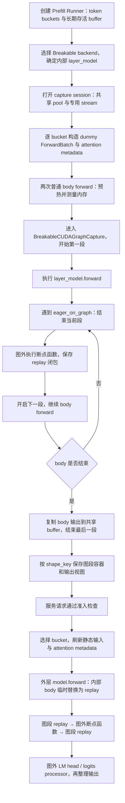

# GPU Prefill Breakable：捕获与执行调用链

日期：2026-10-09。当前 HEAD：`57348d91a2964467cb77531c82a08a5851acf52d`。行号按本次读取的本地文件。

范围：NVIDIA CUDA、普通文本 EXTEND、配置已解析为 breakable。CP、Mamba、LoRA、多模态及模型专用分支存在额外适配。本文为静态源码分析，未实际运行捕获。

## 1. 先分清三层对象

| 对象 | 职责 | 保存什么 |
|---|---|---|
| PrefillCudaGraphRunner | 请求准入、token buckets、静态输入、attention metadata、body 捕获边界、外层尾部和输出整理 | capture_num_tokens、buffer_registry、真实 token/batch 数、可选 per-bucket attention metadata |
| BreakableCudaGraphBackend | 组织捕获 session、两次预热、共享输出分配、按 shape 保存和启动 replay | `_graphs[shape_key]`、`_outputs[shape_key]`、`_capture_inputs[shape_key]`、共享 graph pool |
| BreakableCUDAGraph / BreakableCUDAGraphCapture | 容纳有序图段和断点函数；控制每段 capture_begin/capture_end | `_segments`、`_break_fns`、当前捕获图、stream、pool |

Breakable 不经过 TC Piecewise 的 Dynamo → FX → split_graph → CUDAPiecewiseBackend 路径。它直接执行模型 Python forward，在显式 `eager_on_graph` 断点处结束和重新开始设备图捕获。

`layer_model.forward` 是内部 Transformer body，不是某一个 Transformer layer 的 forward。外层 model.forward 的 LM head / logits processor / pooler 等尾部保持图外执行。

## 2. 总览



## 3. 初始化与捕获准备

### 3.1 构造 Runner

`cuda_graph_setup.capture_prefill_graph` 位于第 448 行，第 647 行构造 PrefillCudaGraphRunner。

Runner 的 `__init__` 位于第 294 行；第 337 行将捕获 token 列表排序为 `capture_num_tokens`。bucket 表示本轮聚合的新 token 数，而不是请求数量。Runner 建立长期存活输入存储和 buffer_registry，供各 bucket 使用稳定地址的视图。

配置已解析为 breakable 时选择 BreakableCudaGraphBackend。它没有 TC backend 的安装 torch.compile trampoline / compile warmup 步骤。

### 3.2 确定捕获范围

Runner `_run_forward` 位于第 781 行。第 810 行判断 `_uses_eager_prefill_tail()`，BCG 进入 body capture 分支；第 823 行调用 `self.layer_model.forward(...)`。

```text
外层 model.forward 的前处理
  → 内部 layer_model.forward：本次分段捕获范围
  → 外层 LM head / logits processor / pooler：图外
```

具体 embedding 是位于内部 body，还是由外层生成并传入，取决于模型实现和输入分支；不能统一断言 embedding 总在图内或图外。

### 3.3 Attention 元数据协议

Runner 第 612 行读取 `attn_backend.use_captured_forward_metadata_for_breakable_cuda_graph`，决定是否保存捕获时元数据。

`_init_forward_metadata_for_capture` 位于第 1169 行：

- 普通路径：调用 `attn_backend.init_forward_metadata(dummy_batch)`。
- 复用捕获元数据路径：调用 `init_forward_metadata_for_breakable_cuda_graph_capture(dummy_batch)`，将返回对象保存到 `attn_metadata_buffers[shape_key]`。

因此 BCG 不应被统一描述为“所有 metadata 全部图外重建”。具体 backend 可以将部分元数据相关工作纳入捕获段，并在 replay 前原地更新对应状态。

## 4. 正式捕获

### 4.1 外层捕获组织

Runner `capture` 位于第 1578 行，负责捕获准备、stream 和 backend session；`_capture_one_stream` 位于第 1600 行，从大到小遍历 buckets。

Breakable backend 的 `capture_session` 位于第 97 行：获取公共 graph memory pool、设置 graph pool ID、记录 capture stream、开启 Breakable 上下文和公共捕获管理。

对每个 bucket T：

```text
capture_one_shape(T)                         Runner:1635
  capture_prepare(T)                         Runner:1640 / 方法定义:1408
  _init_forward_metadata_for_capture(...)    Runner:1681
  run_once = _run_forward(dummy_batch, T)    Runner:1683
  backend.capture_one(shape_key, run_once)   Runner:1717
```

BCG 通常不执行通用 attention 的 post-warmup hook，避免破坏其捕获元数据协议；Mamba 状态池存在专门清理逻辑。相关分支位于 Runner 第 1692–1714 行。

### 4.2 两次预热与输出 buffer

`BreakableCudaGraphBackend.capture_one` 位于第 113 行。第 121 行开始两次普通 forward：

```python
for _ in range(2):
    self._device_module.synchronize()
    self._tp_group.barrier()
    with self._precarve.measure():
        warmup_out = forward_fn()
    if post_warmup_hook is not None:
        post_warmup_hook()
```

两次执行时尚未进入 BreakableCUDAGraphCapture，`eager_on_graph` 包装函数直接执行原函数，不记录断点。预热提前执行 kernel/JIT 等准备，并测量内存需求。

随后第 129 行创建 BreakableCUDAGraph。首次 bucket 捕获时，根据 warmup 输出及 Runner 的容量协议分配共享输出 buffer；各 bucket 保存对应输出视图，而不是各自保留一整套独立大输出 buffer。

### 4.3 开始分段捕获

backend 第 143 行进入 BreakableCUDAGraphCapture，并在其中执行 body forward 和输出复制：

```python
with graph_pool_capture_scope(), BreakableCUDAGraphCapture(...):
    self._precarve.mint()
    out = captured_fn()
    out_rows = self._output_rows(out, size)
    self._copy_output_to_buffer(out, self._shared_output_buffer, out_rows)
```

`BreakableCUDAGraphCapture.__enter__` 位于底层文件第 357 行，设置捕获上下文、stream 和旁路 stream 跟踪，然后启动第一段。

`_begin_new_segment` 位于第 383 行：创建真实 CUDAGraph，调用 `capture_begin(pool=..., capture_error_mode=...)`。开启去重时还会保留 raw graph 并交给公共去重机制注册。

### 4.4 遇到断点时发生什么

`eager_on_graph` 位于底层文件第 222 行，包装函数位于第 243 行：

```text
当前没有捕获上下文？ → 普通执行原函数
正在捕获？
  第249行：结束当前 CUDA Graph 段
  执行可选 rank barrier
  图外运行原函数，或执行 capture_stub
  保存捕获时参数与输出
  第279行：构造 replay_fn
  第283行：追加到 _break_fns
  第286行：开始新的 CUDA Graph 段
  返回本次输出，继续原 body forward
```

`capture_stub` 是可选能力：捕获时可以用替代函数建立输出，预热和服务 replay 仍执行真实函数。不能把所有断点都描述为捕获时必定执行完整真实计算。

普通 attention 断点示例位于 `layers/radix_attention.py:588`：

```python
breakable_unified_attention_with_output = eager_on_graph(True)(
    unified_attention_with_output
)
```

RadixAttention 第 267 行选择 Breakable 包装函数。某些额外 kwargs 走第 247 行附近的专用包装路径；其他稀疏 attention 和模型分支需按实际路径判断，不能据此认为所有 attention 都经过同一个断点。

### 4.5 稳定地址与断点输出

后续图段记录的是捕获时的输入地址。底层第 277–283 行建立桥接：

```python
captured_output = output

def replay_fn():
    new_out = captured_inner(*captured_args, **captured_kwargs)
    return _copy_output(captured_output, new_out)

capture.cuda_graph._break_fns.append(replay_fn)
```

断点参数中的部分设备 tensor 使用弱引用视图；断点输出保留强引用，因为它可能是后续图段读取的固定地址。replay 时将新输出写回这个对象。对本身向预分配 output 写入的 attention，具体额外复制情况取决于返回值形式。

闭包保留捕获时参数对象；请求相关状态必须从当前执行上下文读取，或通过静态 buffer 原地刷新。服务时不会重新运行完整 body Python forward 来重新组织所有参数。

### 4.6 结束捕获与保存

底层 `__exit__` 第 370 行结束最后一段；`_end_current_segment` 第 407 行负责汇合参与捕获的旁路 stream、调用 capture_end 并追加图段。连续断点可能产生空图段，代码允许其作为 no-op replay。

backend 第 156 行开始保存：

```python
self._graphs[shape_key] = graph
self._outputs[shape_key] = stored
self._capture_inputs[shape_key] = capture_inputs
```

与 TC Piecewise 不同，BCG 顶层 backend 明确持有按 shape_key 索引的 body 分段图容器。

## 5. 服务请求的执行

### 5.1 准入与选择 bucket

Runner `can_replay_locally` 位于第 1248 行，`can_run_graph` 位于第 1328 行，检查 token 上限、padding 比例、hidden mode、输入及 backend 特定约束等。具体条件存在 BCG/Full/TC 分支，不应直接照搬 TC 的全部限制。

Breakable backend `can_run` 第 253 行进一步检查 `shape_key in self._graphs`。未通过上层准入的请求走普通执行路径。

### 5.2 输入与元数据刷新

Runner `execute` 第 2196 行进入 backend.replay_session，然后在第 2201 行调用 load_batch。

`load_batch` 第 1730 行：

1. 根据真实 token 数 N 选择 bucket T，记录 raw_num_tokens / raw_bs。
2. 第 1768 行 `buffer_registry.fill_from(...)`，原地刷新输入，按各 slot 策略处理 padding。
3. 建立 static_forward_batch：token-axis 输入指向静态 buffer，保留当前请求语义。
4. 第 2007 行调用 `_prepare_forward_metadata_for_replay`。

该方法第 1189 行定义，BCG 的两条路径是：

```text
不复用捕获元数据：第1227行
  init_forward_metadata(live_batch)
  prepare_prefill_shared_read_snapshot(..., num_qo_tokens=T)

复用捕获元数据：第1234行
  metadata = attn_metadata_buffers[shape_key]
  prepare_forward_metadata_for_breakable_cuda_graph_replay(
      metadata, live_batch, static_forward_batch=...
  )
```

BCG 不使用 Prefill Full 的固定 request-slot padding 协议。同一个 token bucket 可以承载不同请求数和长度分布，但仍要求模型捕获路径、相关状态与 backend 协议兼容。

### 5.3 外层 forward 如何启动 body replay

Runner `_execute_body_capture` 位于第 2046 行：

```text
第2059行：定义 replay_layer_forward
  第2074行：必要时将外层传入的 embedding 写入静态 slot
  第2075行：backend.replay(shape_key, static_forward_batch)

第2080行：临时替换 layer_model.forward
第2110行：建立本轮 forward context，包含 T 和 N
第2115行：执行外层 model_runner.model.forward
第2122行：finally 恢复原 layer_model.forward
```

因此实际执行结构是：

```text
外层 model.forward 前处理
  → layer_model.forward 调用被替换为 body replay
  → 外层 LM head / logits processor / pooler
```

BCG 使用 static_forward_batch 运行尾部，它保留当前请求语义但 token 输入可能已补到 bucket。不要将此路径写成“BCG 在 replay 后无条件先按 N 裁剪所有 body 输出”；代码第 2077 行的该项直接裁剪只针对 Full，BCG 后续由模型尾部及输出协议处理。

### 5.4 真正的分段 replay

Breakable backend `replay` 第 261 行在 graph_pool_replay_scope 中调用所选容器，并返回缓存输出视图。

底层 `BreakableCUDAGraph.replay` 第 303 行：

```python
for i, seg in enumerate(self._segments):
    seg.replay()
    if i < len(self._break_fns):
        self._break_fns[i]()
```

实际顺序：

```text
Graph 0 replay
  → 图外 Attention / 其他断点函数，读取本轮状态
  → 更新桥接输出
  → Graph 1 replay
  → 图外断点函数
  → Graph 2 replay
  → ...
```

replay 直接调用捕获时保存的闭包，不重新经过捕获时用于断图的 wrapper 流程。图外 attention 仍然启动 GPU kernels，不表示 CPU 计算。

### 5.5 输出整理

外层尾部执行后，Runner 在第 2242 行调用 `_finalize_execute_output`，方法定义位于第 2177 行，按输出类型整理 logits、hidden states 或 PP 输出等。

普通 next-token logits 行数由 logits processor 根据真实请求组织，不能将它与 token-major hidden states 的 N 行简单等同。

## 6. 请求示例

假设 buckets=[128,256,512]，以下请求均通过 BCG 准入且模型路径兼容：

| 请求 | 实际 token 数 N | bucket T | 本轮 attention 布局 |
|---|---:|---:|---|
| A：两请求，长度100、80 | 180 | 256 | q 累计边界100、180 |
| B：两请求，长度90、90 | 180 | 256 | q 累计边界90、180 |
| C：单请求，长度170 | 170 | 256 | q 累计边界170 |

三者选择相同的 256-token body 分段图容器，但每次刷新输入及 attention metadata。断点函数处理真实请求布局，并衔接后续固定地址计算段；不是为每种请求长度分布重新捕获一套图。

捕获固定了非断点区域的执行路径。新增模型 Python 分支或可选计算不会因为 token bucket 相同就自动加入旧图，必须由模型适配和准入协议保证。

## 7. 回退和常见误解

- Breakable 不依赖 FX split op 拆图，断点由 eager_on_graph / break_graph 显式表达。
- 一个 bucket 对应一个分段图容器，内部可以有多张 CUDAGraph；不是一张整模型 Full 图。
- 分段数量取决于实际断点，不保证每个 Transformer layer 恰好对应一段。
- 两次 warmup 后还会执行一次正式捕获 forward，不是总共只执行两次。
- Attention 元数据可普通初始化，也可复用捕获元数据；需按 backend 能力区分。
- 此路径更新静态输入和元数据，没有使用 NPU Decode Full 的 NPUGraph.update 机制。
- LM head / logits processor 保持图外，是为了让尾部使用本轮请求语义，不代表它们原则上不可捕获。
- debug_eager 配置会把捕获入口整体包装成 eager_on_graph，主要计算可能转为图外执行，不能用于代表正常 BCG 性能。
- graph pool、断点输出强引用和捕获输入保留共同支撑地址与存储生命周期；不能随意替换其 tensor 存储。

## 8. 阅读顺序与源码定位

| 顺序 | 文件 | 关键符号 / 行号 |
|---|---|---|
| 1 | model_executor/model_runner_components/cuda_graph_setup.py | capture_prefill_graph:448；构造 Runner:647 |
| 2 | model_executor/runner/prefill_cuda_graph_runner.py | __init__:294；buckets:337；metadata 能力:612；_run_forward:781 |
| 3 | model_executor/runner/prefill_cuda_graph_runner.py | _init_forward_metadata_for_capture:1169；_prepare_forward_metadata_for_replay:1189；can_replay_locally:1248；can_run_graph:1328 |
| 4 | model_executor/runner/prefill_cuda_graph_runner.py | capture_prepare:1408；capture:1578；_capture_one_stream:1600；capture_one_shape:1635 |
| 5 | model_executor/runner_backend/breakable_cuda_graph_backend.py | capture_session:97；capture_one:113；两次 warmup:121；保存图:156；can_run:253；replay:261 |
| 6 | model_executor/runner_backend_utils/breakable_cuda_graph/breakable_cuda_graph.py | eager_on_graph:222；wrapper:243；断点闭包:279；BreakableCUDAGraph:294；replay:303 |
| 7 | model_executor/runner_backend_utils/breakable_cuda_graph/breakable_cuda_graph.py | BreakableCUDAGraphCapture:323；__enter__:357；__exit__:370；_begin_new_segment:383；_end_current_segment:407 |
| 8 | layers/radix_attention.py | forward:159；普通 BCG op 选择:267；eager_on_graph 包装:588；额外 kwargs 包装:674 |
| 9 | model_executor/runner/prefill_cuda_graph_runner.py | load_batch:1730；fill_from 调用:1768；_execute_body_capture:2046；_finalize_execute_output:2177；execute:2196 |

路径均位于 `python/sglang/srt/` 下。图示省略特定模型、CP/DP、稀疏注意力和多模态分支，不应作为这些组合已验证支持的证明。
