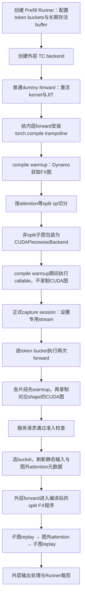

# GPU Prefill TC Piecewise：捕获与执行调用链

日期：2026-10-09。当前 HEAD：`8007167f360126dc35c744a224336cf973f68e4b`。本次涉及的 compilation、Prefill Runner、TC backend、RadixAttention 核心文件与此前分析基线 `8ad24fb560df0e95eb600cd3ce15754bdd1d5276` 无提交差异。

范围：NVIDIA CUDA、普通文本 EXTEND、配置已解析为 tc_piecewise。模型/并行/多模态特殊分支需另查准入条件。本文为静态源码分析，未实际运行捕获。

## 1. 先分清三层对象

| 对象 | 职责 | 保存什么 |
|---|---|---|
| PrefillCudaGraphRunner | 请求准入、token buckets、静态输入、attention metadata、输出整理 | capture_num_tokens、buffer_registry、当前实际 token/batch 数 |
| TcPiecewiseCudaGraphBackend | 安装编译入口、组织编译/捕获 session、从外层 forward 启动执行 | 一个外层 `_compiled_fn`，不是按 shape 的 CUDA Graph 表 |
| CUDAPiecewiseBackend | 一个可捕获 FX 片段的具体 shape 执行、warmup、capture、replay | concrete_size_entries[T]，每项含 runnable、cudagraph、output |

`_compiled_fn` 实际赋值为外层 `model_runner.model.forward`。真正安装 torch.compile 的目标通常是内层 `language_model.model.forward`，外层调用到内层时经 trampoline 进入编译路径。不能把变量名理解为整个外层 forward 都已编译或捕获。

## 2. 总览



## 3. 初始化与编译准备

### 3.1 构造 Runner

`cuda_graph_setup.capture_prefill_graph` 构造 PrefillCudaGraphRunner。Runner 读取 `prefill.bs` 为聚合 token bucket，排序得到 capture_num_tokens，建立 PrefillInputBuffers 与 registry，长期保持输入存储。

`resolve_prefill_backend` 选择 TcPiecewiseCudaGraphBackend。其构造函数立即执行 `_run_compile_pass`，所以不是先完成正式 capture 才开始 torch.compile。

### 3.2 构造 CompilationConfig

`build_compilation_config` 设置捕获 token 列表、compiler（eager/inductor）、debug 开关和 split ops。split ops 包括注册的 unified attention 等；特定 MoE A2A 配置还会追加 split op。

eager compiler 仍可以走 Dynamo/FX 切分与 CUDA Graph 捕获，并不等于关闭 Piecewise。Inductor 是可捕获片段的编译选择，与设备图捕获是不同层次。

### 3.3 激活与安装 trampoline

`_run_compile_pass` 先在最小 token bucket 跑 `_run_dummy_forward`：capture_prepare 构造 dummy batch，attention.init_forward_metadata，再跑外层 forward。用于把 kernel/JIT 一次性准备成本提前。

随后建立共享 graph pool，调用 install_compile → install_torch_compiled，给内层 forward 安装 trampoline。

- TC Piecewise 标记开启时：首次调用触发 `_ensure_compiled`，之后调用 compiled_callable。
- 标记关闭时：执行原始 forward，因此 eager/decode 不会仅因安装 trampoline 就被强制送入 Piecewise。
- 首次 trace 前标记 tensor 动态维度；普通 token-major 输入一般 dim0，mRoPE 的 token 维是最后一维。ForwardBatch 的 tensor 字段也被标记。
- `torch.compile(fullgraph=True, backend=SGLangBackend)` 的 fullgraph 约束是获取完整可编译 FX 区域，不是 CUDA Graph Full 模式。

### 3.4 compile warmup 与 FX 切分

在 enable_torch_compile_warmup 中，从大到小遍历 token buckets，调用 dummy forward，触发 Dynamo → SGLangBackend。

`SGLangBackend.__call__` 调用 split_graph：遍历 FX 节点；遇到注册 split op，将该节点分成单独子图；前后普通计算分到不同子图。split_module 使用 keep_original_order=True，保护 mutation 等操作的顺序。

只有 `not item.is_splitting_graph` 的子图进入 PiecewiseCompileInterpreter。Interpreter 使用 FakeTensor 进行编译组织，对每个可捕获子图：

1. 提取 SymInt 参数位置。
2. CompilerManager.compile(runtime_shape=None) 得到 general/dynamic-shape callable。
3. GPU make_backend 将该子图包装成 CUDAPiecewiseBackend。
4. 用 wrapper 替换 split_gm 中对应 submodule，最终返回 split_gm 给 Dynamo。

因此运行时仍按原顺序串接可捕获片段和 attention split op。FakeTensor 编译组织不是一次真实 CUDA 图捕获。

## 4. 正式捕获

### 4.1 外层捕获组织

Runner 初始化后调用 capture：warmup、设置捕获标记、打开 graph_capture stream，再进入 backend.capture_session。

TC backend 在 session 中打开 Piecewise 标记，并用 set_pcg_capture_stream 暴露 stream。Runner 从大到小遍历 token bucket：

```text
capture_one_shape(T)
  capture_prepare(T)
  init_forward_metadata(dummy_batch)
  run_once = _run_forward(dummy_batch, T)
  backend.capture_one(shape_key, run_once)
```

`TcPiecewiseCudaGraphBackend.capture_one` 本身不创建 CUDAGraph，只同步/barrier 并调用两次 forward。每次 forward 进入编译后的 split_gm，各子图 wrapper 决定 warmup 或 capture。

TC `_run_forward` 调用外层 model.forward。与 Prefill Full/Breakable 不同，它不通过 `_execute_body_capture` 替换整个 layer_model.forward 为单次 body replay。

### 4.2 每个片段的状态机

`CUDAPiecewiseBackend.__call__` 按以下顺序检查：

```text
第一次进入wrapper？ → 执行general callable并记录first_run_finished
没有SymInt？        → general callable
shape未登记？       → general callable
编译warmup标记开启？ → 执行runnable，不捕获
当前shape未warmup？  → 执行一次runnable并计数
没有capture stream？→ 警告并普通执行
尚无CUDA图？        → 录制并缓存graph/output
已有CUDA图？        → 检查地址（debug），replay并返回缓存output
```

通常前面的首次调用已在 compile warmup 消耗；所以正式 capture_one 的两次 forward 分别完成单 shape kernel warmup 与录制。不要将它描述为模型生命周期总共只执行两次 forward。

代码保留 per-shape 专门编译分支，但当前 `compile_sizes` 初始化为空；主要复用 general callable 并针对捕获尺寸录制 CUDA 图，不是每个 bucket 都重新进行一次独立 Inductor 编译。

### 4.3 实际 CUDA 捕获代码

```python
cudagraph = torch.cuda.CUDAGraph()
with graph_pool_capture_scope(), torch.cuda.graph(
    cudagraph, pool=self.graph_pool, stream=stream
):
    output = entry.runnable(*args)
entry.output = weak_ref_tensors(output)
entry.cudagraph = cudagraph
```

debug 模式还记录输入 data_ptr。非首片段避免重复 GC / empty_cache。输出使用 weak reference，生命周期依赖捕获池和后续图引用，不意味着图输出不需要稳定存储。

真实 graph 表位于每个片段 wrapper：`concrete_size_entries[T]`。顶层 TcPiecewiseCudaGraphBackend 没有 `(T→整模型图)` 表。

## 5. 服务请求的执行

### 5.1 准入与输入刷新

ModelRunner 的 EXTEND 分支调用 Prefill Runner 的 can_run_graph。检查 token 上限、padding 比例、输入替换、hidden mode、return_logprob、算法与 attention backend 约束等，不满足则 eager。

`execute` 进入 backend.replay_session，再执行 load_batch：

1. 实际 token 数 N 向上选择 bucket T，保存 raw_num_tokens / raw_bs。
2. registry.fill_from(raw_num_tokens=N, padded_num_tokens=T)：按策略清理 padding、原地复制输入、执行 post_fill 变换。
3. 构造 static_forward_batch：token-axis 输入指向长期存活 buffer 的 bucket view；请求元数据仍保留当前请求语义。
4. `_prepare_forward_metadata_for_replay` 对 TC 路径调用 attention.init_forward_metadata(live_batch)，并执行相应 shared-read snapshot。

TC 不使用 Prefill Full 的固定 request-slot padding 协议。同一个 token bucket 可以对应不同请求数和长度分布，动态部分由图外 attention 处理。

### 5.2 外层 replay 如何启动

`_execute_tc_piecewise` 设置本轮 context：static batch、attention layers、num_tokens=T、raw_num_tokens=N 等，调用 backend.replay。

TC backend.replay 调用保存的外层 model.forward。外层 forward 进入内层 trampoline → compiled_callable → split_gm。每个 CUDAPiecewiseBackend 根据自己的 SymInt shape 选择 entry 并 replay。

因此 ShapeKey(size=T) 是 Runner 的阶段信息；底层子图实际通过参数中的 SymInt 选择 shape 缓存，不是由顶层 backend 查一张整模型图。

### 5.3 attention 边界与稳定输出

RadixAttention.forward 在 Piecewise context 下预分配 output，并调用注册为 split op、声明 mutates_args=[output] 的 unified_attention_with_output。

真实实现 `_unified_attention_with_output_impl` 每次在图外执行：

- 从当前 context 获取 live ForwardBatch 和 layer。
- 将 Q/K/V 缩到真实 token 范围；相应裁剪 cache loc / positions。
- 将预分配 output 的有效部分提供给 attention backend。
- 执行实际 attention 和相应 KV 操作；若返回的是另一块存储，将结果 copy 回预分配 output。
- 恢复临时修改的 batch 字段，清零 padding 输出，避免垃圾值经 residual/MoE/collective 扩散。

输出分配可位于前一个捕获片段，attention 在图外写入该地址，后一个捕获片段从同一地址读取。这是动态 attention 与固定图片段连接起来的关键。

attention 图外执行指未被这些 CUDA 子图捕获，不是 attention 在 CPU 计算；它仍然启动 GPU kernel。

### 5.4 外层输出与裁剪

通常外层 CausalLM 的 LM head / logits processor 不在被安装 torch.compile 的内层主干里，所以继续按外层模型实现处理输出。TC backend 保存外层 model.forward 不代表把外层全部捕获进图。

Runner 最后通过 `_finalize_execute_output` / `_trim_logits_output` 整理 LogitsProcessorOutput、hidden states、PP 输出等。不能将 hidden states 的 raw token 行数与普通 next-token logits 的真实请求行数混为一谈；具体 logits 行数由外层 logits processor 组织。

## 6. 请求示例

假设 buckets=[128,256,512]，且以下请求通过准入：

| 请求 | 实际token数 | bucket | 图外attention有效布局 |
|---|---:|---:|---|
| A：两请求，长度100、80 | 180 | 256 | q累计边界100、180 |
| B：两请求，长度90、90 | 180 | 256 | q累计边界90、180 |
| C：单请求，长度170 | 170 | 256 | q累计边界170 |

A/B/C 对匹配的普通 FX 路径复用每片段的 T=256 图，attention 每次重新读取本轮布局；不是用 Host update 修改图内 attention。若模型 Python 分支/guard 变化触发新的 Dynamo callable，则不能保证自动复用旧片段。

## 7. 回退和常见误解

- fullgraph=True 是 Dynamo 捕获区域约束，TC 最终仍切成多个 CUDA 子图。
- compiler=eager 不等于没有 Dynamo/FX 或没有 CUDA Graph。
- 动态 FX callable 不等于单张 CUDA Graph 支持动态 shape。
- runtime shape 不在 wrapper 表中时执行 general callable；正常服务也可能在更上层已被拒绝或补到某个 bucket。
- runtime recompile 若产生无 capture stream 的 wrapper，GPU 子图代码回退普通执行，避免在服务过程中意外捕获；这可能表现为命中率下降而非请求报错。
- GPU Piecewise 没有 NPU Decode Full 那种 graph.update：更新的是静态输入数据和图外 attention 元数据。
- 图数量近似为可捕获片段数 × 捕获 token buckets，另受 Dynamo guard/模型分支影响；不是请求数 × 模型层数。

## 8. 阅读顺序与源码定位

| 顺序 | 文件 | 关键符号 / 行号 |
|---|---|---|
| 1 | model_executor/model_runner_components/cuda_graph_setup.py | capture_prefill_graph:448；构造Runner:647 |
| 2 | model_executor/runner/prefill_cuda_graph_runner.py | __init__:294；_run_forward:781；capture:1578；capture_one_shape:1635；load_batch:1730；execute:2196 |
| 3 | model_executor/runner_backend/tc_piecewise_cuda_graph_backend.py | _run_compile_pass:154；capture_session:222；capture_one:231；replay:257 |
| 4 | compilation/compile.py | install_torch_compiled:150；_ensure_compiled:198；trampoline:229 |
| 5 | compilation/backend.py | split_graph:230；PiecewiseCompileInterpreter:279；SGLangBackend.__call__:407 |
| 6 | compilation/cuda_piecewise_backend.py | ConcreteSizeEntry:33；__call__:115 |
| 7 | layers/radix_attention.py | forward:159；_unified_attention_with_output_impl:305；split op:434 |
| 8 | model_executor/cuda_graph_buffer_registry.py | fill_from:388 |

路径均位于 `python/sglang/srt/` 下，行号按本次读取代码。图示与调用链省略了特定模型、CP/DP、稀疏注意力和多模态分支，不应作为这些组合已验证支持的证明。
