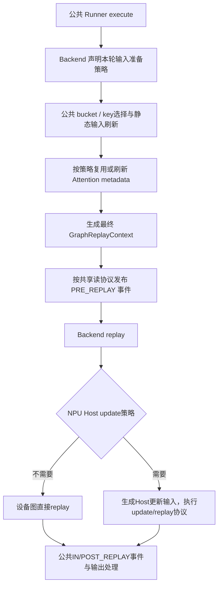

# GraphBackend 重构需求与设计：移除 NPUGraphRunner

日期：2026-10-22。源码基线：`0695c03f55fdf2815069113530286173ed11f7db`。

状态：设计稿，未修改运行时代码，未进行设备测试。本文中的新接口和类名均为建议设计，不代表当前已实现。

## 1. 背景与目标

当前 NPU Decode Full 同时存在 `NPUGraphRunner(DecodeCudaGraphRunner)` 和 `NPUCudaGraphBackend`。设备差异散落在 Runner 与 Backend：Runner 决定 Host 序列长度更新、处理 DFlash 特例，并重写 execute；Backend 执行设备图捕获、异步 update 和 replay。

目标是删除 NPUGraphRunner，让 GPU/NPU 使用统一 DecodeCudaGraphRunner，将 NPU 设备差异收敛到 NPUGraphBackend。Runner 只负责阶段调度、bucket、静态输入的公共管理、图 key、共享读同步和输出整理。

建议将现有 NPUCudaGraphBackend 更名为 NPUGraphBackend，保持其原位置或同步改名文件；避免同时长期保留两个同义实现。BaseCudaGraphBackend 可保持原名称以控制改动范围，GraphBackend 在本文中表示这一抽象层。

### 1.1 必须达到的结果

- 普通 Decode、TARGET_VERIFY 均直接构造 DecodeCudaGraphRunner，NPU 不再依赖 NPUGraphRunner。
- NPU 的图对象、capture 参数、Host 参数更新、线程/fence、compile 和 profiling 差异由 Backend 提供。
- 统一 Runner 不新增 `if device == npu` 或 DSA/V4、FIA、NPU V2 等设备策略分支。
- DSA/V4 保留无需 Host update 的路径；其他相关路径仍能正确更新序列长度。
- 保留 DFlash、预规划 verify、DP、mRoPE、PP、输出扩展字段与共享读同步行为；未支持组合明确保持原支持范围。
- GPU Full、Breakable、TC Piecewise 和其他设备 Backend 不因新增接口改变现有语义。

### 1.2 不属于本次目标

- 不新增 NPU Prefill Full / Breakable 功能。
- 不重写 Attention 算子，不统一各算子的 Host/Tensor 输入协议。
- 不在重构中默认改变异步 update/replay 的同步策略。
- 不顺带改变 bucket、S/K/D、采样、验收算法或模型权重。
- 不以本次重构宣称新增 ragged verify、PP 或某模型支持；这些能力须另有验证。

## 2. 当前实现与问题

| 当前实现 | 位置 | 问题 |
|---|---|---|
| NPUGraphRunner 覆盖 execute | npu_graph_runner.py:238 | 复制公共调度逻辑，容易遗漏 key 变体、共享读事件和输出扩展 |
| 长度更新策略位于 Runner | :139,163,189,375 | 模型/算子属性选择与设备执行分离 |
| 实际 graph.update 位于 Backend | npu_cudagraph_backend.py:156 | Runner 必须知道 NPU 专用 replay_with_input_update |
| 全局替换 patch_model | npu_graph_runner.py:110 附近 | 修改 compilation 模块函数，影响同进程其他 Runner 的行为边界 |
| cache_loc_dtype override | :207 | Backend 在静态 buffer 创建后才构造，早期能力缺少统一入口 |
| 独立 profiling override | :210,234 | 设备 profiling 与公共捕获组织耦合 |
| 部分旧捕获辅助方法 | :160,171,199 | 主捕获链已经委托 Backend，需审计调用者后删除重复实现 |

公共 Backend 接口当前只有 capture_session、capture_one、can_run、replay_session、replay、cleanup，见 `runner_backend/base_cuda_graph_backend.py:28`。

公共 Runner 约第 436/464 行创建 buffer，第 508 行才 resolve backend。不能简单把 `_cache_loc_dtype` 改成 `self.backend.xxx`，否则初始化顺序错误。

### 2.1 按现有定制方法核对：作用、调用点与迁移位置

本节以 `hardware_backend/npu/graph_runner/npu_graph_runner.py` 实际定义的方法为清单。目标位置中的新增方法名为建议接口；不要求保持旧私有方法名。所有“未发现调用”均指本次仓库生产代码静态检索结果，不代表外部插件或动态反射绝无调用；删除前应执行导入与回归测试。

| 现有方法 / 定义行 | 方法作用 | 当前实际调用点 / 调用链 | 重构后位置与处理方式 |
|---|---|---|---|
| `__init__` / 100 | 安装NPU编译patch，调用父类完成buffer/捕获初始化，初始化属性映射、V2与FIA相关状态 | `cuda_graph_setup.py:733`设备映射实例化；`eagle_worker_v2.py:1736`自适应target Runner创建 | 公共`DecodeCudaGraphRunner.__init__`保留阶段初始化；设备状态迁入`NPUGraphBackend.__init__`/捕获绑定规格。Backend所需capture mode等晚就绪字段在bind_resources或capture阶段绑定；禁止在早期构造时读取未初始化Runner字段 |
| `_init_arch_map` / 139 | 建立属性名和参数类型映射；DLLM与普通模型的MHA映射不同 | 当前类`__init__:127`；同名draft方法是另一类的独立实现 | `NPUGraphBackend`的HostInputUpdatePolicy初始化；按捕获记录保存实际使用的键与类型，不把整个映射误当成当前算子选择结果 |
| `_create_device_graph` / 160 | 返回`torch.npu.NPUGraph()` | 当前Decode捕获链未发现调用；主路径由Backend.capture_one直接创建图 | 合并到`NPUGraphBackend.capture_one`或其私有`_create_graph`；删除Runner旧方法，不增加重复入口 |
| `_uses_v2_seq_len_update` / 163 | 根据模型V2标记，以及FIAS V2 BSND与捕获模式，选择V2长度协议；IDLE rank沿捕获模式判断 | `_get_update_attr_name:190`、`_get_update_attr_type:195` | `NPUGraphBackend`的捕获绑定规格/私有策略方法；选择基于捕获协议，不仅依赖本轮runtime mode |
| `_capture_graph` / 171 | 包装NPU graph上下文，传pool/stream/auto_dispatch_capture=True；compile时跳过guard求值 | 当前Decode主捕获链未发现调用；Backend.capture_one已实现同类逻辑 | 合并到`NPUGraphBackend.capture_one`，保留现有warmup、memory-saver和guard语义，删除Runner重复方法 |
| `_get_update_attr_name` / 189 | V2返回actual_seq_kvlen；否则返回MLA映射的actual_seq_lengths_kv | 当前类`execute:408` | `NPUGraphBackend`的HostInputUpdatePolicy / CaptureRecord；replay内部使用，Runner不传属性名 |
| `_get_update_attr_type` / 194 | 选择捕获协议要求的list或CPU tensor类型描述 | 当前类`execute:409` | 与属性名一起迁入Backend绑定规格；禁止属性名/类型由不同层分别推导 |
| `_update_inputs` / 199 | 可选转CPU int32 tensor，再通过`self.graphs[self.bs].update`更新Host输入 | 当前生产路径未发现调用；execute实际调用Backend.replay_with_input_update，未调用该方法 | 删除旧入口；唯一更新实现位于`NPUGraphBackend`。不迁移self.graphs/self.bs式访问，也不保留没有有效调用者的update_attr_name/type字段 |
| `_cache_loc_dtype` / 207 | 为cache location静态buffer选择int32 | 父类`DecodeCudaGraphRunner.__init__`动态派发：第436行输入buffer、第464行registry创建时调用 | `NPUGraphBackend.capabilities.cache_loc_dtype`，通过早期构造/描述在分配前提供；公共Runner只读取能力。GPU维持原dtype |
| `_init_profile_context_and_memory_record` / 210 | 建立torch_npu profiler，记录CPU/NPU活动、shape/memory，通过异步trace handler导出到graph_capture_profile目录 | 父类`capture:1078`，开启capture profiling时动态派发 | `NPUGraphBackend.capture_profile_context(profile_options)`；公共Runner继续控制profiler作用域。torch_npu导入延迟到NPU实现 |
| `_post_process_after_profile` / 234 | 当前为空；NPU trace已通过handler导出，不做GPU式内存内后处理 | 父类`capture:1120`调用 | Backend profiling接口显式完成收尾或提供无操作finalize；不要求复制一个无内容Runner override |
| `execute` / 238 | 刷新本轮输入/元数据，处理预规划和DFlash特例，生成Host长度更新，调用replay并裁剪输出 | `ModelRunner._forward_raw:1917`经decode_cuda_graph_runner.execute动态派发；Runner为NPUGraphRunner时进入此实现 | 不整体搬迁。公共Runner.execute保留调度、key、事件、计时、输出；NPU特殊准备进入prepare_replay，Host更新进入Backend.replay，详见2.3 |

### 2.2 文件级定制函数：`patch_model_npu`

该函数定义于第79行，不是NPUGraphRunner成员，但由该类安装，必须随类移除一起处理。

```text
NPUGraphRunner.__init__:112
  → torch_compile_decoration.patch_model = patch_model_npu
  → 父类 _capture_one_stream:1159
      → torch_compile_decoration.patch_model(...)
      → 返回原model.forward，或npugraph_ex编译后的forward
```

作用：enable_compile时使用`torch.compile(torch.no_grad()(model.forward), fullgraph=True, dynamic=False, backend=npugraph_ex)`；未开启则直接返回model.forward。签名中的num_tokens、tp_group当前函数体未使用，不能据此声称实现了shape或通信特化。

重构后放置于`NPUGraphBackend.capture_forward_context(...)`，由公共捕获循环显式调用并获取callable。删除模块级函数替换，避免NPU Runner创建后改变同进程其他Runner的编译行为。

### 2.3 `execute()` 内部分支的具体归属

execute包含多种职责，下面明确每部分迁到哪里，防止新Backend再复制整套Runner。

| 当前分支 / 行号 | 作用及当前调用 | 重构后位置 |
|---|---|---|
| `needs_forward_metadata_init()` / 243–244 | 未准备时调用公共load_batch | 公共Runner.execute/load_batch，按Backend返回的准备策略执行 |
| 非DFlash预规划 / 246–263 | 不重做metadata、不读CPU长度；补刷input_ids、positions及按条件mRoPE | Backend.prepare_replay返回PREPLANNED_REFRESH与字段需求，公共slot刷新执行；保持DSA/V4路径不新增同步 |
| DFlash预规划特例 / 264–368 | 重新确认B/raw token数，恢复DeepEP模式、DP token数，刷新embedding、mRoPE、长度、req indices、KV写入位置并重新准备metadata | Backend.prepare_replay返回FORCE_REFRESH；公共bucket/registry/build_replay_fb_view执行输入准备；Attention backend执行metadata初始化 |
| `graph_key = _make_graph_key(self.bs)` / 370 | 旧实现按B重建key | 删除；公共Runner生成完整key并传入GraphReplayContext，Backend直接使用 |
| DSA/V4判定与长度准备 / 372–404 | 决定直接replay或Host update；verify处理DFlash长度与验证宽度 | NPUGraphBackend的HostInputUpdatePolicy，读取准备完成后的本轮context/metadata |
| `replay_with_input_update` / 405–410 | 传长度、属性名和类型给NPU后端 | 收敛到NPUGraphBackend.replay内部；公共Runner只调用统一replay入口 |
| 直接`backend.replay` / 411–412 | DSA/V4不做此Host重绑定 | NPUGraphBackend.replay的NONE更新策略，不能跳过上游设备数据刷新 |
| logits/full_logits/hidden裁剪 / 414以后 | 使用raw_num_token整理输出，但旧实现重新构造输出对象 | 公共Runner输出整理，保留dataclasses.replace和扩展字段 |
| PP输出裁剪 / 方法末尾 | 旧实现按bs裁剪 | 公共Runner的token宽度协议；与旧行为差异作为明确修正验收，不静默忽略 |

### 2.4 删除与迁移的判定规则

- 有实际公共调用且属于设备差异：增加Backend接口或能力，由统一Runner委托。
- 有实际调用但属于公共调度/数据管理：复用统一Runner，不下沉整个实现。
- 无当前生产调用且已由Backend覆盖：删除重复方法，不为保留旧方法名新增接口。
- 测试中直接调用旧类私有方法：改为验证新Backend策略或公共Runner组合行为；不能为了旧测试继续保留空壳NPUGraphRunner。
- 字段与调用点一起迁移，特别是if_use_v2/use_fias_v2_bsnd、attr_name/type；当前未被有效路径使用的use_fia/update_attr_name/update_attr_type应先审计再删除，不机械复制到新Backend。

## 3. 职责划分

| 职责 | 统一 Runner | NPUGraphBackend | Attention backend |
|---|---|---|---|
| 模式、B bucket、真实 token 数、完整 ShapeKey | 负责 | 消费结果 | 不重新决定 |
| 通用静态输入 copy/padding | 负责 | 提供特殊准备策略 | 必要时提供元数据计算 |
| 图对象、pool、stream capture 参数 | 调用接口 | 负责 | 不负责图实例 |
| 图外 Attention metadata | 按公共顺序调用 | 指示特殊刷新需求 | 负责具体内容 |
| Host update 属性、类型、顺序 | 不感知属性名 | 负责 | 提供真实长度语义/可选能力描述 |
| DSA/V4 不做 Host update | 不判断模型 | 负责策略选择 | 提供设备 tensor 数据 |
| NPU compile/profiler | 使用抽象接口 | 负责实现 | 不负责公共捕获循环 |
| 输出裁剪与扩展字段保留 | 负责公共处理 | 返回原始捕获输出 | 不重复组装输出 |
| 线程/fence/失败清理 | 调用 cleanup | 负责 | 不持有图更新线程 |

核心原则：迁移设备策略，而不是把 NPUGraphRunner.execute 整体塞进 Backend。Backend 也不能通过不断修改 Runner 私有字段形成新的反向耦合。

## 4. 接口方案

以下为建议接口。具体命名可随实现调整，但必须保持数据所有权与执行顺序清晰。

### 4.1 早期构造：先描述能力，后绑定资源

采用“两阶段构造”，解决 dtype 等能力在 buffer 分配前必须可用的问题：

```text
配置/设备解析
  → resolve_backend_factory：仅选择设备实现
  → backend = factory.create(init_context)：不读取尚未分配的 buffers
  → 根据 backend.capabilities 分配静态 buffers
  → backend.bind_resources(resources)：绑定只需要的长期资源
  → 初始化 Attention 图状态、compile 和捕获
```

InitContext 包含 device、编译开关、模型配置/spec 算法只读描述等已就绪值；不得要求 Runner 完成初始化。其他现有 Backend 可先通过适配器维持原构造方式，再逐步转换。

```python
@dataclass(frozen=True)
class GraphBackendCapabilities:
    cache_loc_dtype: torch.dtype
    supports_ragged_verify: bool

class BaseCudaGraphBackend(ABC):
    @property
    @abstractmethod
    def capabilities(self) -> GraphBackendCapabilities: ...

    @abstractmethod
    def prepare_replay(self, request: ReplayRequest) -> ReplayPreparation: ...

    @abstractmethod
    def replay(self, shape_key, static_forward_batch, *, replay_state=None): ...
```

保留当前纯 ABC 风格；新增方法必须更新所有设备/模式实现。GPU、Breakable、TC 等的 prepare_replay 返回明确的普通策略，不隐式继承 NPU 默认值。

### 4.2 ReplayRequest：携带真实输入与规划状态

建议只读请求描述包含：

- live_forward_batch、pp_proxy_tensors。
- capture_forward_mode、captured_req_width、阶段标识（decode / target_verify / draft_decode / draft_extend）。
- 当前预规划结果引用及有效性标识；不能仅依赖 needs_forward_metadata_init=False 推断所有 buffer 均已准备。
- bucket/variant 选择所需公共上下文。

ForwardBatch 本身仍可能可变；“只读”指 Backend 不随意重绑公共字段，而不是 frozen dataclass 能冻结其所有对象。

### 4.3 ReplayPreparation：声明输入准备需求

返回结构描述策略，不直接重复公共 execute：

| 字段 | 含义 |
|---|---|
| input_policy | NORMAL / PREPLANNED_REFRESH / FORCE_REFRESH |
| refresh_fields | 需追加原地刷新的已注册 slot，例如 mRoPE/input_embeds |
| metadata_policy | 复用有效预规划结果，或在公共输入刷新后重新初始化 |
| need_cpu_lengths | 是否需要准备 Host 长度；DSA/V4 快速路径为 False |
| replay_state | 本轮 Backend 私有状态，仅传给此次 replay，不放进全局变量 |

公共 Runner 继续计算/验证 B、raw_B、token 数和完整 ShapeKey，再通过 registry 执行复制与padding。必要的静态资源以窄接口提供给 Backend，不允许 Backend 重写 Runner.bs 等字段。

DFlash 当前特殊逻辑迁移为 NPUGraphBackend 的 preparation 策略：没有有效预规划时强制重新选择/确认 bucket，刷新 DP token、seq_lens/CPU副本、req indices、cache loc、必要 embedding/mRoPE，然后公共调用 metadata 初始化。通用复制能力复用 Runner/registry，不在 Backend 再复制一份字段清单。

### 4.4 ReplayContext：准备完成后的最终事实

在输入与 metadata 准备结束后创建上下文，至少包含：

```python
@dataclass(frozen=True)
class GraphReplayContext:
    phase: str
    shape_key: ShapeKey
    capture_forward_mode: ForwardMode
    raw_bs: int
    padded_bs: int
    raw_num_tokens: int
    padded_num_tokens: int
    captured_req_width: int
    live_forward_batch: ForwardBatch
    static_forward_batch: ForwardBatch
    metadata: object
    replay_state: object
```

Backend 不可用 `_make_graph_key(bs)` 重建 key；必须使用 Runner 最终选择的完整 key，保留 stream、attention、LoRA、sampling 等变体。

对 metadata 提供稳定 getter 或准备完成时的明确对象；混合 Attention wrapper 必须能定位本轮有效子元数据，不能假设顶层一定有 seq_lens_cpu_list。

### 4.5 捕获编译与 profiling 接口

新增或抽象现有调用点：

```python
backend.capture_forward_context(model, compile_enabled, num_tokens, tp_group)
# 上下文返回实际 capture callable；GPU 保留现有patch_model策略

backend.capture_profile_context(profile_options)
# 返回设备 profiler 上下文，关闭时为普通空上下文
```

NPU compile 使用现有 npugraph_ex、fullgraph=True、dynamic=False 语义。删除全局 monkey-patch；不改变另一台设备或另一个 Runner 的 compile 入口。

## 5. 统一执行流程



建议在保持现有 replay 三参数接口的过渡阶段，通过显式 keyword 传 GraphReplayContext；最终统一为单一有类型的上下文接口，避免长期同时接受 live/static 两种不明确语义。

必须审计当前各调用点：公共 Decode execute 实际传入 live batch，draft/extend 的 `_replay_graph` 也传 live batch，虽然参数名叫 static_forward_batch。重构不得直接按旧参数名假设它总是静态 batch。

## 6. seq_len 更新设计

### 6.1 捕获绑定规格

每个捕获 key 保存 NPU 专用 CaptureRecord：

- graph、output、必要的输入所有者。
- 捕获模式与阶段、固定宽度、实际调用的算子更新协议。
- Host 更新键、数据类型、更新项个数、是否需要 update。
- 生命周期代次 generation，防止重捕获后旧异步任务操作新记录。

优先按捕获时已选算子/backend能力建立规格；第一阶段允许保留当前模型/flag判断以保证行为等价，但全部判断必须位于 NPU Backend 内。

### 6.2 各阶段行为

| 路径 | Host 更新策略 |
|---|---|
| DSA/V4 当前对应分支 | NONE，静态 tensor / metadata 仍正常刷新 |
| 普通 decode | 使用本轮有效 KV 长度并按协议补空槽 |
| target verify | 按算法语义包含验证宽度；DFlash优先使用已计算的有效长度，禁止重复加D |
| V2 Attention | 使用 actual_seq_kvlen；按捕获模式选择，IDLE rank也不能误选V1键 |
| 普通相关 MLA路径 | 使用 actual_seq_lengths_kv |
| draft decode | 为S−1个内部forward分别提供长度+step+1；保留顺序 |
| draft extend decode | 一次extend对应的有效长度，遵循extend输入协议 |

不能把映射表中的 context_lens 自动当成所有MHA的实际更新键；当前getter默认与映射表并非一一按架构选择。迁移先忠实保持当前真实选择，并为每个实际算子建立测试。

### 6.3 数据与更新契约

- Host list/CPU tensor 类型必须匹配捕获时算子handler协议。
- 区分原始prefix长度、已包含验证块的长度和draft step长度，避免二次增加。
- 空槽长度、CPU dtype、设备dtype遵循对应backend协议。
- 优先使用现有CPU长度或已准备metadata，不新增不必要的device→host同步。
- DSA/V4无需Host长度的预规划路径必须维持不新增D2H/.item()/全设备同步。
- replay只能消费当前上下文的长度，不读取上次保存在Backend的可变live batch。

## 7. 异步更新、fence 与资源释放

现有顺序为：等待上次rebind fence → worker提交graph.update → 主线程graph.replay → future.result → 记录fence。

重构阶段默认保留此策略，隔离在 NPUGraphBackend 中；不能未经验证改成同步等待update再replay，也不能删除fence。应确认目标torch_npu版本对update/replay的运行时契约，保证replay使用本轮绑定。

要求：

- worker初始化绑定正确device，单worker及当前每Backend串行使用语义不变。
- Host更新数据在设备最后一次使用前保持有效。
- update或replay失败必须将异常传到调用线程，禁止返回陈旧output假装成功。
- cleanup先停止新任务、等待已提交任务和必要设备使用完成，再释放图与输出。
- recapture使用新generation；旧任务不能访问已替换的graph。
- 若未来支持同一Backend并发replay，需另外设计锁与资源隔离，本次不默认宣称支持。

## 8. 差异迁移清单

| NPUGraphRunner现有内容 | 目标位置 / 处理 |
|---|---|
| patch_model_npu和全局patch | NPUGraphBackend.capture_forward_context，删除全局修改 |
| _init_arch_map / V2判断 / getter | Backend CaptureRecord与HostInputUpdatePolicy |
| _create_device_graph / _capture_graph | Backend现有capture_one统一承接，确认无调用后删除旧方法 |
| _update_inputs | 并入Backend唯一更新入口，删除重复图表访问 |
| _cache_loc_dtype | Backend早期capabilities，先于buffer分配生效 |
| NPU profiler / postprocess | Backend profiling接口 |
| execute普通load/preplanned分支 | 公共Runner + Backend准备策略 |
| execute DFlash补刷新 | Backend声明FORCE_REFRESH，公共slot/metadata刷新实现 |
| seq_len构造与Host update选择 | NPUGraphBackend，统一普通/verify/draft/extend策略 |
| graph_key重建 | 删除，统一使用最终GraphReplayContext.shape_key |
| logits/hidden/PP输出处理 | 删除NPU重复实现，使用公共输出处理并保留扩展字段 |

### 8.1 MTP与其他入口

- cuda_graph_setup.py的npu设备映射改为DecodeCudaGraphRunner，删除NPUGraphRunner import。
- eagle_worker_v2.py adaptive target runner创建同样改为公共Runner。
- draft/extend NPU Runner的Host更新逻辑应并入Backend，以phase参数区分。初版允许保留这些类的薄适配，但不得再自行计算seq_len并调用专用update入口。
- 多层draft extend、Eagle draft extend、其他NPU图Runner逐个审计；不因名称相似就强制套用普通Decode更新策略。
- CPU/GPU环境import不应强制导入torch_npu；设备依赖维持lazy import。

### 8.2 MTP：`_capture_cuda_graphs()` 的修改范围

本次完整重构应同时覆盖 MTP 的设备差异，而不仅删除 target NPUGraphRunner。保留阶段专用 Runner，消除其仅为 NPU 设备差异建立的子类。迁移完成前不能只替换设备映射。

`eagle_worker_v2.py:451` 的 `_capture_cuda_graphs()` 只创建 draft decode 和 draft extend-for-decode 图；target verify 由 target ModelRunner 的公共图初始化创建，不在此函数中捕获。

| 创建入口 | 当前NPU类型 | 目标 |
|---|---|---|
| Device2DraftCudaGraphRunner | EAGLEDraftNpuGraphRunner | 公共 EAGLEDraftCudaGraphRunner + NPUGraphBackend |
| Device2ExtendCudaGraphRunner | EAGLEDraftExtendNpuGraphRunner | 公共 EAGLEDraftExtendCudaGraphRunner + NPUGraphBackend |
| target verify 常规/自适应创建 | NPUGraphRunner | 公共 DecodeCudaGraphRunner + NPUGraphBackend |

两个公共 draft Runner 已调用 resolve_decode_backend，位置分别为 `eagle_draft_cuda_graph_runner.py:281`、`eagle_draft_extend_cuda_graph_runner.py:299`。应复用该后端选择链，不在 worker 中再创建第二套 NPU graph/update 管理对象。

修改步骤：先完成 dtype、Host update、准入策略迁移，再将两个设备映射中的 npu 项切换为公共类，删除无生产引用的 NPU 子类和 import。其他设备映射保持原语义，后续可另行统一工厂。

以下逻辑必须保持：

- CPU、Decode graph disabled、MindSpore 等现有跳过条件。
- S>1 才创建 draft decode 图；不因重构额外为 S=1 捕获空图。
- draft 与 draft extend 分别捕获、分别统计耗时与显存。
- draft extend backend 存在、SGLANG_DISABLE_DRAFT_EXTEND_CUDA_GRAPH 未启用等条件。
- GPU/HIP 的 Attention backend 支持判断，以及原有 NPU/XPU 放行语义。后续可改为设备图能力与 Attention 阶段能力的联合查询，但不能直接放宽支持范围。
- draft extend 作为末个共享读取阶段的事件发布与调度器 WAR barrier 协议。

### 8.3 MTP：显式阶段与静态捕获参数

Backend 必须显式接收 GraphPhase（建议枚举），不能只看 ForwardMode：普通 decode 与 draft decode 均可能使用 DECODE，但捕获 callable 和更新次数不同。

| GraphPhase | 捕获描述 | Host更新协议 |
|---|---|---|
| DECODE | 通常每请求1 token的一次forward | 一组本轮有效KV长度 |
| TARGET_VERIFY | 算法派生宽度，一次target forward | 验证有效KV长度；保留V2、DFlash语义 |
| DRAFT_DECODE | 每步B×K，图中通常S−1次draft模型forward | 非DSA/V4时按step顺序提供S−1组长度 |
| DRAFT_EXTEND | B×D，一次draft extend forward | 非DSA/V4时提供本轮extend长度 |

捕获描述至少包括 phase、S/K/D或实际派生宽度、capture_forward_mode、完整shape_key、采样变体。ReplayContext至少包括 raw/padded batch、真实/补齐token数、当前CPU长度及可用metadata。

阶段在 Runner 创建时确定，S/K/D 与捕获记录绑定；replay 时校验请求布局匹配。不允许直接将普通 Decode 的长度更新策略应用到 draft 或 extend，也不允许用 S+1 代替 D。

### 8.4 MTP：NPU 专用类差异逐项迁移

| 当前差异 | 迁移目标 | 约束 |
|---|---|---|
| 两类NPU Runner的_cache_loc_dtype | Backend早期capabilities | int32在buffer分配前生效；当前公共Runner分配早于resolve backend，必须先调整初始化协议 |
| draft属性映射/getter | Backend捕获绑定规格 | 保持当前实际键和类型，不按映射表猜测 |
| draft `_replay_graph` | Backend DRAFT_DECODE策略 | 生成S−1组长度+step+1并补空槽；一张图内多个更新项 |
| extend `_replay_graph` | Backend DRAFT_EXTEND策略 | 使用阶段输入定义的长度，不套用逐步增长公式 |
| DSA/V4直接replay | Backend NONE更新策略 | 保留设备metadata刷新，不新增无意义Host更新 |
| draft seed/DP准入投票 | 公共准入流程 + Backend局部设备条件 | 所有rank必须一致进入图或eager，不能遗漏collective |

### 8.5 MTP：DSA seed 跨 rank 准入检查

`EAGLEDraftNpuGraphRunner.can_run_graph`（第59行附近）除Host更新之外还有重要行为：当 seed_dsa_topk_from_draft_extend 且 attention DP>1 时，将父类准入与本轮 seed 就绪状态组合，再在模型 TP group 上做 MIN all-reduce。IDLE rank按既有规则处理。

直接把 npu 映射改为公共 Runner 会丢失此逻辑，可能使真实请求rank回退eager，而其他rank进入图，引发通信顺序不一致。

建议设计为：

```text
公共Runner计算基础准入
  → Backend/设备策略计算局部seed等额外条件
  → 公共阶段准入协调器按固定策略执行一次跨rank投票
  → 得到所有rank一致的最终结果
```

投票是否启用必须由所有rank一致的配置决定，不能由rank本地seed是否存在决定。不能因本地基础准入为False就提前返回并跳过其他rank正在执行的投票。

现有 backend.can_run 部分路径只在disable-padding时调用，因此不能仅把投票搬入该方法就认为覆盖所有请求。必须在 padding / no-padding 两条路径均会执行的最终准入位置接入；若使用统一 finalize_graph_admission 接口，应为各Backend提供明确实现并保持collective调用次数一致。

### 8.6 MTP 迁移顺序与验收

1. 记录draft/verify/extend现有捕获key、宽度、更新payload和最终准入行为。
2. Backend接入显式phase，迁移dtype及三阶段更新策略。
3. 接入seed/DP最终准入投票，覆盖padding/no-padding与IDLE场景。
4. 替换 `_capture_cuda_graphs()` 的NPU映射；target常规与adaptive创建同时切换公共Runner。
5. 删除不再承担设备差异的NPU draft/extend子类；多层/其他算法保留独立审计结果。

MTP追加验收项：

- S=1不创建draft图；S>1内部forward数量与更新项数量一致。
- K>1且D不等于S+1时捕获/复制不越界。
- 非DSA/V4的draft和extend均通过Backend.replay完成Host更新，Runner不直接调用replay_with_input_update。
- seed缺失、seed存在、部分DP rank为IDLE、不同rank基础准入不同，最终图/eager选择一致且不挂起。
- GPU原有backend白名单和draft-extend开关行为不变。
- verify图仍走target公共图链，未被错误地在draft worker重复捕获。
- adaptive配置切换时三阶段捕获描述、资源与generation保持一致。

## 9. 兼容性与行为约束

- CLI、默认backend、capture buckets和现有模型支持范围保持不变。
- Full/Breakable/TC的公共接口变更必须同步实现，不通过NPU全局开关影响GPU。
- Attention metadata仍由Attention backend负责，GraphBackend只承接设备图协议与必要的阶段策略。
- 公共输出采用dataclasses.replace保留LogitsProcessorOutput扩展字段；PP裁剪沿公共token宽度协议。若与旧NPU行为不同，作为明确兼容性修正单独列测试和变更说明。
- 同样保留公共计时、capture hooks、共享读事件、DeepEP模式恢复和完整图key；接入这些公共行为后要验证NPU对应backend能力，不只做源码合并。
- ragged/特殊variant若NPU尚不支持，通过capability及can_run明确拒绝或回退，不自动放开。

## 10. 分阶段实施

1. 记录基线：图key、输出、seq_len更新payload、事件顺序和捕获/执行耗时；梳理所有旧辅助方法调用点。
2. 建立Backend早期能力与资源绑定，迁移dtype、compile、profiler；GPU与NPU仍保留旧执行路径便于比较。
3. 建立ReplayRequest/Preparation/Context，将普通与预规划输入准备统一，覆盖DFlash特殊刷新。
4. 迁移Host update策略，普通Decode、verify、draft、extend均从Backend.replay进入。
5. GPU/NPU统一execute和输出处理，删除NPUGraphRunner类及所有生产引用。
6. 迁移原测试、设备回归和性能对比，删除过渡兼容分支。必要的临时回滚分支仅存在开发阶段，不引入长期双实现。

## 11. 验收要求

| 类别 | 必须验证 |
|---|---|
| 结构 | 生产代码不再定义/实例化/导入NPUGraphRunner；统一Runner无NPU模型策略分支 |
| 初始化 | NPU cache loc为int32且在分配前确定；GPU原dtype不变；无全局patch_model污染 |
| 普通Decode | 上下文逐轮增长、B小→大→小，logits/hidden与基线/eager一致 |
| MTP verify | B×D、预规划/非预规划、IDLE rank、mRoPE、不同接受长度均正确 |
| DFlash | 没有真实预规划也能刷新B、DP token、seq_len、cache loc和metadata，不重复加D |
| DSA/V4 | 不调用Host update；设备长度正确更新；预规划快速路径不新增Host同步 |
| V1/V2接口 | 正确属性名、类型、列表数量与捕获协议一致 |
| draft/extend | S/K/D变化、S=1、topk>1、select_index与验收字段正确 |
| 图key | variant/stream/LoRA等信息不丢失；unsupported组合明确拒绝 |
| 同步 | shared-read事件覆盖真实共享读；update异常传播、cleanup/recapture无悬挂任务 |
| 输出 | logits扩展字段不丢失；PP按token宽度裁剪；图输出生命周期正确 |
| 回归 | GPU Full、Breakable、TC及CPU可导入与原有测试通过 |
| 性能 | 比较同硬件/版本/配置的capture峰值显存、常驻显存、每token延迟、D2H次数；具体允许阈值由项目评审确定 |

测试分为纯CPU mock契约测试、NPU单设备数值/同步测试、多卡DP/TP测试、GPU回归。CPU mock不能证明设备异步顺序或显存生命周期正确。

现有 `test/registered/unit/npu/graph_runner/test_npu_graph_runner.py` 直接构造旧类，必须迁移为公共Runner + NPU Backend策略的组合测试，保留其DFlash预规划回归意图。

## 12. 源码索引与待确认事项

| 文件 | 关键位置 |
|---|---|
| hardware_backend/npu/graph_runner/npu_graph_runner.py | patch_model_npu:79；类:97；映射:139；getter:189；dtype:207；profiler:210；execute:238 |
| hardware_backend/npu/graph_runner/npu_cudagraph_backend.py | 类:42；capture_one:89；replay:147；update:156；cleanup:196 |
| model_executor/runner_backend/base_cuda_graph_backend.py | ABC:28 |
| model_executor/runner/decode_cuda_graph_runner.py | buffer dtype使用:436,464；backend构造:508；compile入口:1159；load_batch:1307；execute:1526 |
| model_executor/model_runner_components/cuda_graph_setup.py | 旧NPU Runner导入:20；设备映射:733 |
| speculative/eagle_worker_v2.py | 旧NPU Runner导入:20；adaptive创建:1736 |

实施前需要确认：目标torch_npu版本update/replay契约、实际V1/V2算子handler类型、NPU对shared-read事件/特殊图key的支持、DFlash wrapper metadata访问契约。它们是实现验证项，不阻止先完成接口与职责重构设计。
