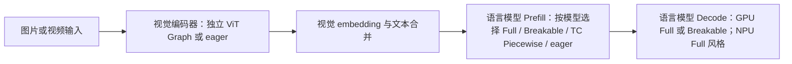
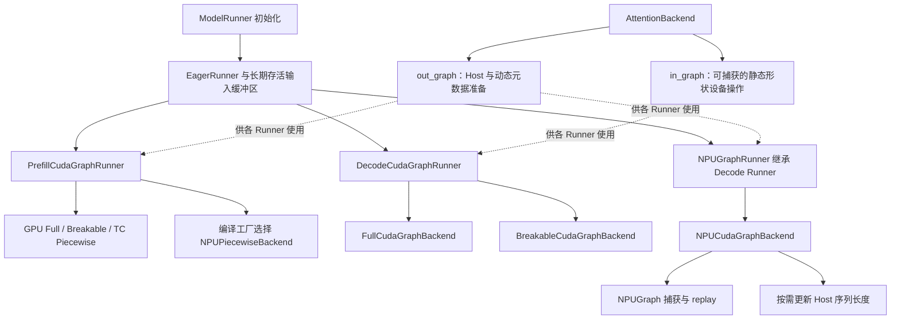
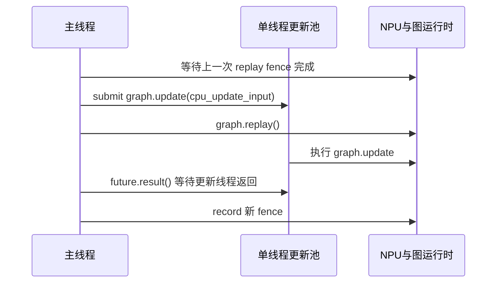

# SGLang GPU / Ascend NPU Graph 实现分析

分析日期：2026-10-08。代码基线：`10-8-main`，提交 `8ad24fb560df0e95eb600cd3ce15754bdd1d5276`。

用户确认：本文“社区/GPU”与“NPU”指当前分支中的两种硬件实现，不是两个 Git 分支。当前 HEAD 与本地 `sgl-project/main` 相同，左右提交差为 `0 / 0`；该本地远端引用不代表本文已联网 fetch 验证最新 main。工作区现有 `docs/tp_pp_flow_analysis.md`、`test.py` 未改动。

本文重点是 SRT 大模型推理的 Decode、Target verify、Draft、Prefill 与 ViT Graph；不展开 Diffusion/VLA 的独立 Graph 系统。结论来自源码静态分析与既有测试内容检查，未运行 GPU/NPU 真机测试，也不提供未经测量的性能数字。

## 按阶段与图类型速查（2026-10-09 补充）

此处 GPU 指当前代码的 NVIDIA CUDA 路径。支持状态以实际 backend 分派为准，不以配置枚举是否允许输入为准；均未经过本次真机验证。

### 图类型定义

| 类型 | 捕获方式 | 动态部分怎么处理 |
|---|---|---|
| Full | 一次捕获该阶段选定的 forward/body 区域 | 固定形状分桶、padding、静态 buffer 原地更新；NPU 部分算子额外更新 Host 参数 |
| Breakable | 通过显式 break marker 分段捕获，不要求 torch.compile | 在段间以 eager 执行注意力/Mamba 等动态区域 |
| TC Piecewise | torch.compile/FX 按 split op 切分，分别捕获子图 | 动态区域留在图外，具体 token shape 使用缓存片段 |
| ViT 专用图 | 捕获视觉 blocks、merger 与可选 deepstack merger | 按视觉 token 数和注意力布局缓存，更新输入与 rotary buffer |

ViT 是模型组件的专用捕获边界，不是与 Full/Breakable/TC Piecewise 同一层级的全局配置选项。`disabled` 是 eager 执行策略，不是一种图。

### 一、Prefill 阶段

| 图类型 | GPU | NPU | 当前选择逻辑 |
|---|---|---|---|
| Full | 有实现，实验性 | 未接入 NPU 专用 Full Prefill backend | Prefill Full 工厂直接构造 GPU Full backend；不能从 NPU Decode Full 推导 Prefill Full 可用 |
| Breakable | 有实现；CUDA 初始默认，之后受兼容规则调整 | 未接入 NPU 专用 Breakable backend | 分段捕获；模型、通信、并行与多模态条件可能令其禁用或改选其他 backend |
| TC Piecewise | 有实现，受模型与配置约束 | 有 NPUPiecewiseBackend；需显式开启并验证组合 | NPU 初始配置是 TC Piecewise，但自动兼容检查将 NPU 列为禁用条件；显式指定 Prefill backend 会跳过自动禁用规则 |

Prefill 的 bucket 轴是**聚合 token 数**。Full 另有固定 request-slot 上限；超出捕获范围的请求走 eager。NPU TC Piecewise 的存在与其默认关闭策略并不矛盾：前者是实现能力，后者是保守的自动配置策略。

### 二、Decode 阶段（含相关 Verify 路径）

| 图类型 | GPU | NPU | 当前选择逻辑 |
|---|---|---|---|
| Full | 有实现，默认 | 有实现，默认 NPU Graph 路径 | GPU 选择 FullCudaGraphBackend；NPU 选择 NPUCudaGraphBackend |
| Breakable | 有实现，可配置 | 未接入独立 NPU Breakable Decode 路径 | NPU 工厂优先返回 Full 风格 backend，即使配置名写为 breakable 也不能获得 NPU 分段图 |
| TC Piecewise | 当前未实现，警告后回退 Full | 未接入 NPU Piecewise Decode 路径 | NPU 同样返回 Full 风格 backend；Prefill 的 NPUPiecewiseBackend 不用于这里 |

普通 Decode 的 bucket 轴是**请求数**；Verify 还要满足每请求 token 宽度、算法和图变体等契约。投机解码的 Draft/Verify 是用途与阶段细分，不应当再列成一种与 Full 并列的捕获机制。

### 三、多模态：必须拆开视觉编码器与语言模型

| 多模态组件 | GPU | NPU | 关键限制 |
|---|---|---|---|
| 视觉编码器 ViT | 专用 CUDA Graph；通用 Runner 及模型专用 Runner | 专用 ViTNpuGraphRunner | 模型需接入；NPU 专用捕获逻辑要求 ascend_attn；同总 token 不同布局通常需不同图 |
| 语言模型 Prefill / Full | 通用实验性实现 | 未接入 NPU 专用 backend | 不代表所有 VLM 已验证；需检查模型 forward 与实际输入准入 |
| 语言模型 Prefill / Breakable | 白名单模型可保留启用 | 未接入 NPU 专用 backend | 通用多模态自动规则会禁用，白名单例外 |
| 语言模型 Prefill / TC Piecewise | 白名单模型可保留启用 | 编译层有 NPU 实现，但不能据 GPU 白名单宣称 NPU VLM 已验证 | 只捕获语言部分；视觉处理与 embedding 准备有独立边界 |
| 语言模型 Decode | 沿 GPU Decode Full/Breakable 机制，受 batch 条件限制 | 沿 NPU Full 风格机制 | mrope、encoder length、动态图输入等需符合 graph admission 契约 |

当前 GPU 多模态 Prefill 白名单（`configs/model_config.py`）：

- **TC Piecewise**：KimiK25、MiniMaxM3Sparse 的 CausalLM / ConditionalGeneration 架构。
- **Breakable**：Cohere2Vision、Glm5Next、InternS2Mobius、PaddleOCRVL、Qwen3_5、Qwen3_5Moe、Qwen4Exp、MuseGlimmer、KimiK3、KimiK25 对应的 ConditionalGeneration 架构。

CUDA 初始默认 Breakable；多模态模型若只在 Piecewise 白名单、未在 Breakable 白名单，自动策略可改选 TC Piecewise；未满足相应条件则自动禁用。显式配置可以绕过自动规则，但不会自动补齐硬件实现或提供模型正确性保证。

**阅读多模态支持结论时，分别确认三个问题：视觉编码器是否捕获、语言 Prefill 是否捕获、语言 Decode 是否捕获。不存在仅凭“多模态 Graph 已开启”就能断定三者均入图的统一结论。**

源码依据：`model_executor/cuda_graph_config.py`（类型与初始默认）、`runner_backend/utils.py`（实际分派）、`arg_groups/cuda_graph_hook.py`（兼容与白名单策略）、`configs/model_config.py`（模型白名单）、`multimodal/vit_cuda_graph_runner.py` 与 NPU 同名组件（视觉捕获）。

## 1. 结论先行

**NPU 复用了社区的 Runner、静态输入缓冲区和捕获分桶框架，但在“注意力算子的动态主机参数更新”以及部分执行入口上保留了专用实现。框架复用程度高，行为上的泛化程度仍由具体算子、注意力架构和推理模式共同决定。**

| 核心问题 | 结论 |
|---|---|
| GPU 如何支持动态请求？ | 将变化的请求映射到预捕获的 shape bucket；原地刷新静态 tensor；需要时选择不同图变体或回退 eager。不是一张图任意改变形状。 |
| NPU 的核心增量是什么？ | 除 tensor 原地刷新外，对部分融合注意力算子的 Host 参数调用 `NPUGraph.update(cpu_update_input=...)`，捕获时开启 `auto_dispatch_capture=True`。 |
| 所有 NPU 模型都需要 update 吗？ | 否。当前 Target 和部分 EAGLE Runner 对 DeepSeek DSA / V4 跳过 Host update，依靠各自元数据与设备缓冲区路径。 |
| NPU 有没有 Prefill 分段图？ | 有 `NPUPiecewiseBackend`，按具体 token shape 捕获片段；Decode 的平台工厂仍固定选择 NPU Full 风格 backend。不能把两者混为一谈。 |
| 泛化瓶颈在哪里？ | Host 参数名及类型绑定、模型名特判、verify 长度语义、跨 rank 一致性、混合模型状态、图键与通用执行入口的行为漂移。 |
| 最值得优先检查什么？ | NPU 的 PP verify 输出按请求数切片；NPU execute 重建图键时省略 stream/LoRA/attention 维度；异步 update 与 replay 的底层同步契约。 |

## 2. 整体结构与捕获边界

### 2.1 社区公共抽象

- **Runner 管数据与阶段**：捕获 batch/token bucket、静态输入、padding、hidden states、输出裁剪。
- **Backend 管捕获机制**：capture session、单 shape 捕获、replay、内存池、清理。
- **AttentionBackend 管元数据**：`init_forward_metadata_out_graph` 每轮在图外执行；`init_forward_metadata_in_graph` 中的设备操作在捕获时入图，replay 自动执行。
- **ShapeKey 管图身份**：`size`、`stream_idx`、`variant_label`、`attention_variant`。普通 Decode 的 size 是请求数；部分 ragged verify / Prefill 使用 token 数。

这一抽象比旧式单一 `cuda_graph_runner.py` 更细。阅读当前代码时，应从 `model_executor/runner/`、`runner_backend/` 和 `model_runner_components/cuda_graph_setup.py` 入手。

### 2.2 “更新”的三个不同含义

| 更新层次 | 典型内容 | 是否重新捕获图 |
|---|---|---|
| 输入数据更新 | input_ids、positions、seq_lens、out_cache_loc 原地 copy | 否 |
| 注意力元数据更新 | block table、query offsets、稀疏索引、Mamba state slot | 通常否；要求写入捕获图绑定的存储 |
| NPU Host 参数更新 | `actual_seq_lengths_kv` / `actual_seq_kvlen` 等 | 否，调用 NPUGraph update |
| 图结构或捕获契约变化 | 请求宽度、分支、hidden mode、图变体、并行几何发生变化 | 需另一张预捕获图、重新捕获或 eager |

不能将 NPU 的 update 解释为任意改变 batch、tensor shape 或计算拓扑；也不能说 GPU 不更新：GPU 持续刷新数据与元数据，只是当前 Full backend 没有对应的 Host rebind 调用。

## 3. GPU 如何捕获与重放

### 3.1 Full Decode

1. 分配长期存活的静态缓冲区，建立捕获 bucket。普通 decode 每请求一个 token，verify 每请求使用固定 `captured_req_width`。
2. `capture_prepare` 建立 dummy ForwardBatch，预先调用 attention 的 out_graph 元数据入口。
3. `run_once` 内调用 in_graph 元数据入口及模型 forward；Backend 先运行两次 warmup，并在其间 synchronize 与 TP barrier；再录制 `torch.cuda.CUDAGraph`。
4. 每轮 `load_batch` 选择 bucket、刷新静态输入、准备 attention 元数据并保存完整 `_replay_graph_key`。
5. `execute` 在 replay session 中重放选定图，执行通用后处理，再裁剪输出；PP 输出以 `bs * captured_req_width` 个 token 行切片。

捕获遍历通常从大 bucket 到小 bucket，有利于内存复用。GPU Full backend 使用公共 graph pool、`GraphPoolPrecarve` 和 capture/replay scope；可按配置接入 memory saver。Prefill Full 还能复用输出缓冲区。

### 3.2 分段捕获的两种机制

| 机制 | 如何划分 | 适用边界 |
|---|---|---|
| Breakable | 通过 eager break marker 分割 Graph，不依赖 torch.compile；注意力/Mamba 边界可回到 eager | 动态部分较复杂时保留固定计算片段；仍需遵守分段缓冲区与并行通信契约 |
| TC Piecewise | torch.compile/FX 按注意力等 split op 切图，具体 shape 缓存子图 | Prefill token 数变化较大时复用片段；受编译、模型白名单和配置约束 |

当前 GPU Decode 配置 `tc_piecewise` 会警告并回退 Full；不能把 Prefill 的 TC Piecewise 能力直接套到 Decode。Full Prefill 在配置代码中明确标为 experimental。

## 4. NPU 捕获与更新机制

### 4.1 捕获与基础差异

`NPUGraphRunner(DecodeCudaGraphRunner)` 复用公共初始化、capture bucket、输入和 attention 元数据组织；`resolve_decode_backend` 遇到 `device == "npu"` 直接返回 `NPUCudaGraphBackend`。

| 维度 | GPU Full | NPU Full 风格 |
|---|---|---|
| 图对象 | `torch.cuda.CUDAGraph` | `torch.npu.NPUGraph` |
| 录制入口 | device graph context | `torch.npu.graph(..., auto_dispatch_capture=True)` |
| warmup | 两次，含同步与 TP barrier | 两次，含同步与 TP barrier |
| cache loc dtype | 默认 int64 | int32 |
| Compile | 通用 patch/compile 路径 | `npugraph_ex`、fullgraph=True、dynamic=False；替换通用 patch_model |
| 动态参数 | tensor / metadata 原地刷新 | tensor / metadata 刷新，另有按需 Host rebind |
| 内存池 | 公共 global pool + precarve + scopes | backend 的 pool handle，未镜像上述全部机制 |
| replay 输出 | 通用后处理与保留 dataclass 扩展字段 | 专用 execute 构造输出，当前只显式保留 logits/full_logits/hidden_states |
| Decode backend 选择 | Full / Breakable，TC 回退 Full | 工厂固定 NPU backend；disabled 由更上层处理 |

NPU Runner 中仍存在 `_create_device_graph`、`_capture_graph`、`_update_inputs` 等方法，但公共捕获实际落在 Backend。分析有效路径应沿调用链，不能仅依据这些旧 helper 或顶部注释判断运行时行为。

### 4.2 Host 参数与模型分派

当前 Target Runner 中：

- 通常更新 `actual_seq_lengths_kv`，参数类型是 Python list。
- MiMoV2、MiMoV2Flash、Step3p5 架构，或者满足 DSpark + FIAS V2 BSND 的 target verify，使用 `actual_seq_kvlen`。
- `_uses_v2_seq_len_update` 对 verify 的判定参考捕获模式，使运行时 IDLE rank 仍选择与已捕获 verify 图一致的 Handler。
- 虽然映射表包含 MHA 的 `context_lens` 与 Tensor 类型，当前 getter 默认返回 MLA 对应项；不能仅看映射表就断言所有 MHA 图都更新 context_lens。
- 对 DeepSeek DSA、DeepSeek V4，execute 直接 replay，跳过上述 Host update。

这说明更新协议取决于实际调用的融合算子和 Handler，而不只是模型是否属于 MHA/MLA。新增模型若复用了旧模型类型但调用了不同算子，模型名分派未必足够。

### 4.3 Verify、DFlash 与 Draft 的长度语义

| 路径 | 更新值来源 | 特别要防止的问题 |
|---|---|---|
| 普通 decode | live seq_lens，padding 补 0 | 捕获时长度被固化，未随上下文增长 |
| 常规 target verify | live seq_lens + captured_req_width | 漏加 verify token，或取了旧 capture list |
| DFlash target verify | 优先读取 replay metadata 的 seq_lens_cpu_list | metadata 已包含 draft block，不可再次加宽度 |
| EAGLE draft | 每 speculative step 使用 seq_lens_cpu + step + 1，多字典传给 update | 每一步长度不同，不能全部绑定同一个初始长度 |
| EAGLE draft extend | CPU seq_lens，属性 actual_seq_lengths_kv | 与 draft decode/target verify 不是同一种更新 |
| Multi-layer draft extend | 静态 CPU buffer，属性 actual_seq_kvlen | 不同 Runner 使用的参数名不同 |

DFlash 的专用 preplanned 路径还会重算 bucket，恢复 DeepEP dispatch 模式，刷新 DP token buffer、seq_lens、req_pool_indices、out_cache_loc 和 attention metadata。其目的不仅是更新“长度”，还包括确保实际 KV 写入位置、跨 rank gather 几何与捕获时相符。

DSA / V4 跳过 Host update **不等于跳过元数据更新**。Ascend attention 使用静态 block table 和 seq_lens 缓冲区；DSV4 另有压缩相关 graph buffer、页表复制与稀疏元数据入口。

### 4.4 异步 update 的实际顺序

注意：图中的主线程 replay 与 worker update 的相对到达次序并不由 Python submit 保证。

**代码事实**：update worker 固定绑定设备，单线程复用；先等待上次 replay fence，随后提交 update，主线程立刻 replay，再等待 future；因此不能描述成“update 完成后才调用 replay”。

**待验证契约**：本轮 replay 是否安全读取新参数，依赖 TorchNPU Handler / 图运行时的内部等待与更新语义。厂商文档确认存在动态参数 update 机制，但该概览不足以证明当前并发调用顺序对所有相关算子、版本和多 stream 都成立。不能据此直接认定竞态 bug，也不能把 Mock 测试通过当作底层时序证明。

跨轮 fence 保护上一轮尚在读取的 Host 参数；它也引入 Host 等待点。小 batch 是否因此抵消部分启动收益，需要在真机 trace 中测量。

## 5. Prefill 与多模态的独立路径

### 5.1 NPU Piecewise Prefill

编译层 `make_backend` 能选择 `NPUPiecewiseBackend`。它继承 CUDA piecewise 基础逻辑，对未配置 shape 调用 general callable；对捕获 shape 先 warmup 一次，再录制 NPUGraph；后续直接 replay。debug 模式检查 tensor data_ptr 是否变化，输出通过 weak reference 管理。

它没有沿用 Decode 的 `replay_with_input_update`。要实现正确泛化，动态 Host 逻辑应留在片段边界之外，或由对应算子机制独立处理；不能假设 Decode 的长度 rebind 会自动覆盖 Prefill 子图。

配置层仍将 NPU 列在 TC Piecewise 的默认不兼容检查中，但**显式指定 Prefill backend 会提前跳过这组自动禁用规则**。现有 NPU piecewise 测试正是显式指定 backend，并使用 Qwen2.5-7B。

因此准确表述是：**实现和测试入口存在，但不是由默认规则声明为普遍可用；显式开启也不等于所有模型通过验证。** `resolve_prefill_backend` 的 Full/Breakable 分支并未像 Decode 一样切换到 NPU 专用 backend，不能凭枚举中有这些选项就认定 NPU 上实现了相同能力。

### 5.2 ViT Graph

NPU ViT 继承通用 ViT Runner，捕获 blocks + merger，可选 Qwen3-VL deepstack merger；目前专用创建逻辑要求 `ascend_attn`。

图键默认包含 `(总 token 数, attention layout)`，layout 含累计序列边界。例：总 token 同为 1024，`[0,512,1024]` 与 `[0,256,1024]` 应使用不同图。否则仅按总 token 数复用，会错误沿用捕获时的 Host cu_seqlens。

replay 原地刷新输入和 rotary workspace，Host cu_seqlens 按键固定；因此它选择“布局进图键”，而 Decode 选择“Host 参数 update”。模型提供自定义 attention_layout_key 时，应确保该 key 唯一表达影响注意力的布局。

泛化代价是不同图片/视频切片布局可能产生更多图与内存占用。ViT Graph 可用与文本 decoder Graph 可用是两项独立能力；VLM 服务测试成功也不自动证明两者都命中 replay。

## 6. 模型与部署场景泛化矩阵

下表的“较好”描述实现结构的适配程度，不是认证或实测通过。真正的验证单位应是“模型 × attention backend × dtype/量化 × 推理阶段 × 并行配置”。

| 模型/场景 | GPU 路径 | NPU 路径及限制 | 泛化判断 / 验证重点 |
|---|---|---|---|
| Dense MHA/GQA，如 Llama/Qwen 文本 decode | Full + 静态 buffer / metadata | Full 风格 + FIA 等 Host 长度更新 | 较好；必须确认实际算子参数名、padding、上下文增长 |
| MLA，如 DeepSeek 非 DSA 路径 | 相应 attention backend 提供 graph metadata | Host actual_seq_lengths_kv 等更新 | 按算子适配；不可直接套用 MHA 参数协议 |
| DSA，如 DeepSeek V3.2 类 | 稀疏元数据、attention variant | 跳过 Host update，刷新稀疏索引和设备长度 | 专门适配；检查索引来源、seed 缺失回退和 DP 一致性 |
| DeepSeek V4 | 独立 attention/压缩路径；Prefill 默认策略考虑内存压力 | V4 graph buffer、压缩/页表路径；跳过通用 Host update | 专用性强；长短序列交替、页表残留列、压缩边界 |
| MiMoV2 / Step3p5 | 由 GPU attention backend 决定 | Host 参数切换 actual_seq_kvlen | 体现模型名特判；新架构可能要显式补更新协议 |
| EAGLE / MTP | 独立 draft、draft extend、target verify 图 | 专用 NPU subclasses，每步更新列表 | 有实现；检查树结构、topk、多步长度、hidden states |
| DFlash / DSpark | verify shape 与算法相关 | DFlash 专用刷新；DSpark 可走 V2 参数 | 专门适配；长度不能重复累加，IDLE 与 active rank 契约一致 |
| Mamba/GDN/KDA 混合线性注意力 | 分段图可保留动态边界；有状态元数据 | Ascend state slot、query offsets、状态回滚与 attention 组合 | 不能只验证 logits；还需验证 state 写入、padding 与 rollback |
| SWA 混合注意力 | mask / cache translator 按 backend 管理 | 专门的 block_tables_swa、swa_mask、out_cache_loc 缓冲区 | 窗口边界、物理 cache 位置必须单独覆盖 |
| MoE + TP/EP/DP | Graph 内通信要求形状与各 rank 路径一致 | DeepEP mode 恢复、全局 bucket/DP token 刷新 | 计算模块可复用；通信和 idle rank 是额外边界 |
| PP + speculative verify | 输出按 token 行 `bs * width` 保留 | 当前输出只按 `bs` 切片 | 明确代码差异，见下一节；应优先验证 width > 1 |
| LoRA / PDMux / attention variant | 完整 ShapeKey 保持图变体身份 | 专用 execute 只用 `_make_graph_key(self.bs)` | 有行为漂移风险，不能照搬 GPU 的支持结论 |
| VLM 文本 decoder | 模型白名单与 graph backend 约束 | 文本路径沿 NPU decoder；mrope 部分路径专门刷新 | 与 ViT 分开验证，覆盖图片/视频/纯文本切换 |
| ViT / Qwen2.5-VL / Qwen3-VL 类接口 | 通用 ViT layout key、workspace | ascend_attn + layout key + 可选 deepstack | 接口约束下适配；布局多样性可能导致图数增长 |
| Encoder-decoder / embedding / rerank | decoder mixed encoder_len 有 guard；非生成模型不捕获 Decode | 部分继承 guard，但不是所有模型都存在 decode | 不能以模型能服务推导 Graph 可用 |
| 动态 replace_embeds / 未捕获 bucket | 通用 can_run_graph 回退 | 继承部分 admission guard | 应验证实际 fallback 命中，不能静默套用旧图 |

## 7. 代码差异、潜在问题与置信边界

### 7.1 PP verify 切片差异：优先级高

GPU 返回 `PPProxyTensors({k: v[:bs * captured_req_width] ...})`；NPU 返回 `v[:bs]`。

例：capture bucket bs=4，verify width=8，GPU 保留 32 个 token 行，NPU 当前保留 4 行。如果 PP 中间张量第一维确实按 token 排布，NPU 将截断 verify 数据。这是明确的代码差异；是否被现有配置禁用、实际可达并导致错误，需结合 PP + NPU + speculative 场景验证。普通 decode width=1 时该差异不显现。

### 7.2 图键重建省略变体：优先级高

GPU execute 使用 load_batch 保存的完整 `_replay_graph_key`；NPU execute 使用 `_make_graph_key(self.bs)`，stream_idx、variant_label、attention_variant 均取默认 None。

如果捕获存在非默认 key，可能查不到图，或选择默认图而非正确变体。需要验证各功能在 NPU 上的准入限制：**这是条件性风险，不是已证明所有 NPU LoRA/DSA 都失败。** Ragged verify 还可能将 token bucket 当成 bs 重建 key，不能因继承 admission 逻辑就推导兼容。

### 7.3 通用执行尾部与同步逻辑未完整继承

GPU execute 包含 replay session、shared-read 完成发布、device timer、`_process_output_after_replay`，且用 `dataclasses.replace` 保留输出扩展字段。

NPU 专用 execute 没有对应的完整调用链，并重新构造 LogitsProcessorOutput。因此后续向通用 Runner 增加 eager tail、辅助输出、shared buffer 生命周期能力时，NPU 不会自动获得同等行为。是否影响具体场景取决于这些能力的启用条件；不能将 NPU rebind fence 等同于通用 shared-read fence，它们保护的对象不同。

### 7.4 模型名特判与 Host 参数类型

同为 attention 的算子可能要求不同 Host 属性名，Python list 与 CPU Tensor 的绑定语义也不同。代码特意不在 capture metadata 中设置 seq_lens_cpu_int，以保证某些 verify 算子绑定可 rebind 的 list。

建议将更新协议提升为 attention backend 的显式能力：属性名、参数类型、长度偏移、每步实例数量、是否需要 Host rebind。混合 backend 应组合子 backend 的协议，而不是让 Runner 通过模型名或访问单一 forward_metadata 猜测。

### 7.5 Compile monkey patch 与内存机制漂移

NPUGraphRunner 初始化直接替换 `torch_compile_decoration.patch_model`，没有在此处恢复原函数。同进程多 Runner / 多平台测试时要核查作用域。GPU Full 的 global pool、precarve、memory saver CPU backup 和 cleanup reset 在 NPU Backend 中并不完全对应；这是功能差异，不能仅凭差异断言泄漏或内存不安全。

## 8. 现有证据与建议验证矩阵

### 8.1 已检查的测试

| 现有文件 | 能证明什么 | 本次不能据此证明什么 |
|---|---|---|
| unit/npu/graph_runner/test_npu_cudagraph_backend.py | Mock 层 warmup/capture、输出复用、list→int32 转换、pool session 组织 | 真实 update/replay 并发正确性、所有融合注意力 Handler 的行为 |
| unit/npu/graph_runner/test_npu_graph_runner.py | DFlash preplanned replay 的部分刷新与输出裁剪组织 | 全模型各模式、PP、完整 ShapeKey 与多 rank 正确性 |
| unit/npu/graph_runner/test_npu_graph_capture.py | 提供真实设备基础捕获、静态 tensor 更新 replay 用例 | 融合注意力 Host 参数更新与端到端服务正确性 |
| unit/multimodal/test_vit_npu_graph_runner.py | attention 边界参与 ViT 图键 | 各种图像/视频布局的精度、显存与命中率 |
| registered/npu/basic_function/optimization_debug/test_npu_piecewise_graph_prefill.py | Qwen2.5-7B 显式 piecewise 的精度/时延测试入口存在 | 本次运行通过、默认开启、其他模型或并行配置通过 |

这些是测试内容检查，**本次未执行上述测试**。仓库中更多 NPU 模型精度测试也不能单凭文件存在证明 Graph 路径命中，需检查实际配置、日志和 profiler。

### 8.2 建议的验证顺序

| 优先级 | 场景 | 必须观察 |
|---|---|---|
| P0 | PP=2，普通 decode 对照 verify width>1 | 各 PP stage 的 token 行数、logits 与 eager 一致性 |
| P0 | 同 bucket 内 seq_lens 大幅交替，持续多轮 | Host update 是否每轮生效、是否读旧长度；与强制串行 update 对照 |
| P0 | active / IDLE DP rank + verify，batch 数不均衡 | 所有 rank 的 graph/eager 决策与 collective 形状一致 |
| P1 | LoRA 切换、attention variant、PDMux | 捕获 key 与 replay key 完全对应；不支持时明确拒绝或 fallback |
| P1 | DFlash 前缀 + draft block，边界 bucket | 长度只加一次，out_cache_loc 和 block table 每轮刷新 |
| P1 | DSA/V4、SWA、混合 GDN/KDA | 索引/页表尾部清理、窗口边界、state rollback 与 eager 等价 |
| P1 | ViT 同总 token 不同序列布局 | key 正确区分布局，输出一致，图数与显存可控 |
| P2 | piecewise Prefill、compile on/off、量化组合 | 实际 replay 命中率、recompile 次数、shape miss fallback |
| P2 | 图重捕获、memory saver、清理后再捕获 | 资源生命周期和输出扩展字段保持正确 |

性能报告应分别记录 capture 时间、图内存、replay 命中率、padding 比例、Host update/fence 等待、TTFT/ITL、吞吐与尾延迟。先确保 graph/eager 等价，再比较性能。大 bucket padding 与 Host 等待都可能影响收益，不能只看单次 replay API 耗时。

## 9. 改进方向

1. **将 NPU execute 的差异收敛为公共 Runner 的 hook**：保留通用图键、PP token 切片、shared-read 生命周期与输出后处理，仅覆盖 Host update。
2. **由 AttentionBackend 声明更新协议**：替代模型名特判，允许混合 backend 聚合多个参数更新，并区分固定宽度 verify、DFlash、每 draft step。
3. **显式表达硬件 × 阶段 × backend 能力**：NPU Decode Full、Prefill Piecewise、ViT 各自独立；对未接入平台路径的配置明确拒绝或回退。
4. **增加行为导向的真机验证**：以长度变化、bucket 边界、idle rank、PP width、图变体和状态回滚为中心，避免仅按模型列表扩展用例。
5. **记录 TorchNPU/CANN 版本与更新契约**：确认哪些 Handler 支持并发 update/replay，并提供串行对照定位路径；不要在未测量情况下改动异步顺序。

## 10. 源码导航与外部依据

以下源码路径均相对于仓库根目录；为便于复核，每项列出应搜索的符号。

| 主题 | 源码路径 / 符号 |
|---|---|
| 初始化与阶段选择 | `python/sglang/srt/model_executor/model_runner_components/cuda_graph_setup.py`：capture_cuda_graphs / capture_decode_graph / capture_prefill_graph |
| 公共 Decode | `python/sglang/srt/model_executor/runner/decode_cuda_graph_runner.py`：capture_one_shape / load_batch / execute / can_run_graph |
| 图身份 | `python/sglang/srt/model_executor/runner/shape_key.py`：ShapeKey |
| GPU Full | `python/sglang/srt/model_executor/runner_backend/full_cuda_graph_backend.py`：capture_one / replay |
| 分段机制 | 同目录 `breakable_cuda_graph_backend.py`、`tc_piecewise_cuda_graph_backend.py` |
| 硬件工厂 | 同目录 `utils.py`：resolve_decode_backend / resolve_prefill_backend |
| 元数据契约 | `python/sglang/srt/layers/attention/base_attn_backend.py`：AttentionBackend / SharedReadEnds |
| NPU Target | `python/sglang/srt/hardware_backend/npu/graph_runner/npu_graph_runner.py`：_uses_v2_seq_len_update / execute |
| NPU 捕获与 update | 同目录 `npu_cudagraph_backend.py`：capture_one / replay_with_input_update |
| NPU Draft | 同目录 `eagle_draft_npu_graph_runner.py`、`eagle_draft_extend_npu_graph_runner.py`、`multi_layer_eagle_draft_extend_npu_graph_runner.py` |
| NPU attention | `python/sglang/srt/hardware_backend/npu/attention/ascend_backend.py`：_init_cuda_graph_metadata / _apply_cuda_graph_metadata / forward_decode_graph / forward_mtp |
| DSV4 与 hybrid | 同目录 `ascend_dsv4_backend.py`、`ascend_hybrid_linear_attn_backend.py` |
| NPU Piecewise | `python/sglang/srt/compilation/npu_piecewise_backend.py`、`backend.py`：make_backend |
| Prefill 自动兼容规则 | `python/sglang/srt/arg_groups/cuda_graph_hook.py`：apply_cuda_graph_compatibility / disable_tc_piecewise_cudagraph_if_incompatible |
| ViT | `python/sglang/srt/hardware_backend/npu/graph_runner/vit_npu_graph_runner.py`；`python/sglang/srt/multimodal/vit_cuda_graph_runner.py`：_get_graph_key |

可固定版本复核的 [社区源码提交](https://github.com/sgl-project/sglang/tree/8ad24fb560df0e95eb600cd3ce15754bdd1d5276)。本文以本地该提交的实际内容为准。

外部文档仅用于确认基础 API 语义，不代替本仓库调用链与实际依赖版本验证：

- [PyTorch CUDA semantics](https://docs.pytorch.org/docs/stable/notes/cuda)：固定地址输入输出、通过原地写入刷新数据的基本约束。
- [TorchNPU 26.1 NPUGraph 开发说明](https://www.hiascend.com/document/detail/en/Pytorch/2610/devguide/fwfeatures/docs/en/framework_feature_guide_pytorch/pytorch_npugraph_desc.md)：动态算子参数的 update 与 auto_dispatch_capture 机制。该版本说明不是本地部署已安装版本的证明，也不足以证明所有跨线程调用时序。
