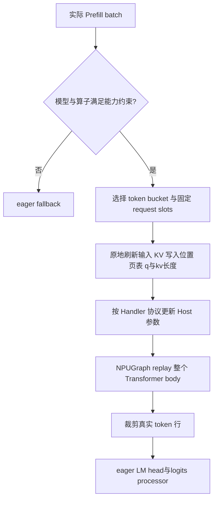

# NPU Prefill Full：缺口分析与支持方案

日期：2026-10-09；基线：`8ad24fb560df0e95eb600cd3ce15754bdd1d5276`。
本文是源码分析与建议设计，未修改运行时代码，未执行 NPU 测试。支持范围须按具体 TorchNPU/CANN 版本和算子验证。

## 结论

当前 NPU Prefill Full 未打通，原因不是 NPUGraph 原理上不能捕获 Prefill，而是 **后端分派、Runner 能力判断、Prefill 元数据、注意力算子路径和 Host 参数更新协议尚未共同接入**。

Decode NPUGraph 和 NPU Piecewise Prefill 能提供部分基础设施，但不能证明整个 Prefill Transformer body 已具备静态形状与动态参数更新契约。首版建议仅支持 Dense MHA/GQA + TND 融合注意力 + TP1 + 无前缀缓存；通过后再扩展 paged KV 前缀与 TP。

## 1. 已确认的代码缺口

| 缺口 | 当前源码事实 | 直接复用 Decode backend 为什么不够 |
|---|---|---|
| 平台路由 | resolve_prefill_backend 的 full 分支构造 FullCudaGraphBackend，其中创建 torch.cuda.CUDAGraph | 必须选用 NPU 图对象及其捕获上下文 |
| Runner 类型判断 | `_is_full_backend = isinstance(backend, FullCudaGraphBackend)`；静态字段、layer_model、LoRA 等也以具体 GPU 类型判断 | NPUCudaGraphBackend 继承 BaseCudaGraphBackend，直接替换后不会进入完整 Full 初始化流程 |
| Prefill 元数据 | Ascend out_graph 调用 `_init_cuda_graph_metadata` / `_apply_cuda_graph_metadata`，主要为 decode/verify 组织 | 没有完整提供 EXTEND 需要的 query lengths、累计 query 边界、prefix 等契约 |
| 捕获元数据内容 | Ascend graph 初始化只为 verify/draft 或 decode 构造相应 q 元数据，且刻意不设置 seq_lens_cpu_int；eager EXTEND 则设置 extend_seq_lens_cpu_int、seq_lens_cpu_int 和 seq_lens_list_cumsum | Prefill forward_extend 读取这些字段，不能拿 decode metadata 直接顶替 |
| 初始化生命周期 | Prefill Runner 没有通用调用 Ascend init_cuda_graph_state 的路径；启动时先捕获 Prefill 再 Decode | 不能依赖“Decode 已初始化 graph_metadata/block_tables”；Prefill 需独立分配并防止后续 Decode 覆盖 |
| Host 参数更新 | NPU backend 的普通 replay 仅调用 graph.replay；更新在专用 replay_with_input_update 中 | 公共 Prefill body replay 调用普通 replay，不会自动更新 Prefill attention Host 参数 |
| Prefix 能力 | Ascend 未声明 supports_full_cuda_graph_chunked_prefix；基类默认 False | 默认 chunked-prefix 开启时，接入 Full 后还会触发能力检查；不应强行设 True |

Runner 已通过 `_cache_loc_dtype` 为 NPU 返回 int32，这部分可复用，无需再次修改为一套独立输入缓冲区系统。

## 2. 算子层的真正难点

### 2.1 TND 融合注意力：首版最有希望，但需双侧长度更新

Ascend `forward_extend` 的 FIA TND 分支一次处理多个请求，使用：

- query 侧累计序列边界：`actual_seq_lengths`，或 V2 的 `actual_seq_qlen`。
- KV 侧每请求长度：`actual_seq_lengths_kv`，或 V2 的 `actual_seq_kvlen`。
- 静态页表与 KV Cache。

Prefill 即使总 token 数相同，请求切分也不同，例如 `[3,5]` 与 `[4,4]`，query 累计边界分别为 `[3,8]` 与 `[4,8]`。只刷新 KV 长度不能更新注意力分界。

建议由 attention backend 构造 Prefill update payload，覆盖实际算子需要的 q 与 kv 参数。上述名字来自调用点；Handler 是否支持相应类型、多个同名调用、多层/多实例映射和并发更新，须查验部署版本并真机验证，不能仅根据字典名字推定支持。

### 2.2 Python 按请求循环：捕获时会固化拓扑

非 TND 的 BSND 分支存在：

```python
seq_lens_cpu = forward_batch.seq_lens.cpu().tolist()
for seq_idx, q_len in enumerate(forward_batch.extend_seq_lens_cpu):
    if q_len == 0:
        continue
    # 按 q_len 切片，调用注意力，将输出写回对应区域
```

CPU 回读可能无法在捕获中执行；即使移到图外，Python 循环、跳过零长度请求和按长度切片也只在捕获时执行。Replay 不会重新运行循环，输入切分变化后仍沿用旧 kernel 数量、旧切片大小和偏移。

优先改用单次 TND/ragged 融合调用。若某模型只能使用 BSND，需设计固定 slot 的固定形状计算与有效长度 mask，或将布局纳入图键；后者可能产生大量图，不能称为已实现通用 Full Prefill。

### 2.3 Padding：不能继续按真实 token 数在 Python 中裁 query

现有 TND Prefill 分支可根据 `global_num_token_non_padded_cpu` 裁 q/k/v，再拼回零输出。Full replay 时该 Python 控制值和切片形状不会自动变化。

应保证图内 q 与输出维度始终为捕获 bucket T，通过算子可更新长度或设备 mask 排除 padding。需要验证：重复累计边界（零长度槽位）、末尾未使用 token、全 padding/idle 语义、KV padding 写入安全性。若算子不支持这些语义，首版先限制精确 token bucket 或固定非零 slot 布局，未满足时 eager。

### 2.4 其他分支不能一并宣布支持

- FlashAttention NPU 分支在 forward 内有 `extend_seq_lens.max().item()`，应将 max length 的准备移到图外或固定合法上限，并确认算子捕获契约。
- MLA 路径有按 q_len 的 Python 循环；带前缀路径还涉及动态 gather 大小及额外 ring MLA 计算。
- DSA/V4、SWA、Mamba/GDN/KDA 有独立索引、压缩、窗口和状态更新。
- CP/DP/EP/PP 引入 collective 几何、idle rank、state/metadata 生命周期等条件。

这些问题有的发生在图外元数据准备，有的发生在捕获 body 中。图外 `.cpu()`/`.item()` 不会直接阻止捕获；真正要消除的是捕获区中的不合法同步，以及 replay 无法改变的 Python 分支/形状。

## 3. 建议修改清单

| 模块 | 修改内容 | 首版边界 |
|---|---|---|
| runner_backend/utils.py | Prefill full 遇到 NPU，选择可处理 Prefill 的 NPU Full backend | 不改变 GPU 分派 |
| runner_backend/base_cuda_graph_backend.py 与具体 backend | 提供 body capture、Full 形状语义、输出复用等明确能力，替代 Runner 中 GPU 类型判断；也可先用统一 helper 过渡 | 不建议为绕过 isinstance 而让 NPU backend 假装继承 GPU 实现 |
| runner/prefill_cuda_graph_runner.py | 用上述能力初始化 `_capture_req_slots`、静态字段、layer_model、eager tail、Full replay 元数据；确保 `_is_full_backend` 逻辑对 NPU 生效 | 保留 body graph + eager LM head/logits |
| npu/graph_runner/npu_cudagraph_backend.py | 增加 Prefill update 与 replay 的明确入口；payload 来源为 attention backend；保留 capture-stable 输入输出引用 | 首先使用可验证的串行 update/replay；异步优化须基于 Handler 契约 |
| npu/attention/ascend_backend.py | 新增 EXTEND Full metadata 状态；固定页表、query 边界、KV 长度等缓冲区；replay 原地刷新；与 decode 状态分离 | Dense TND，无 prefix，TP1 |
| Ascend forward_extend | 新增或选择 Full-graph-safe 分支；不按 live CPU 长度变更循环次数、切片形状或分配规模 | 不影响 eager 与现有 piecewise 分支 |
| arg_groups/cuda_graph_hook.py / 平台策略 | 以平台、attention backend、模型能力判定 NPU Prefill Full 是否允许；不支持的显式配置清楚报错或按明确策略回退 | 禁止仅绕过自动禁用就进入未经适配的路径 |
| 测试 | 添加实际融合注意力与整模型图内外等价验证、路径命中验证和后端契约测试 | Mock 不能代替 Handler 真机测试 |

### 3.1 Prefill 状态应独立拥有

建议至少区分 `phase=EXTEND` 与 `phase=DECODE/VERIFY`，并按必要的 token bucket / slot / 算子变体保存 metadata。Ascend 当前 graph_metadata 主要以 bs 为索引，而 Prefill 在同一固定 slot 数下有多个 token bucket；是否能共用 buffer，要证明最大容量足够、地址稳定和串行 replay 生命周期，不能让 capture 覆盖旧图引用的元数据。

缓冲区包括：req indices、out_cache_loc、block table、q 累计边界、extend lengths、prefix lengths、KV lengths、实际有效 token 数。Host list 需按 Handler 协议 rebind；设备 tensor 原地 copy。不要仅替换 forward_metadata 的 Python 对象就认为旧图能读取新地址。

### 3.2 Prefix 支持有两条路线

1. **首版限制无前缀**：使用现有开关关闭 chunked-prefix 拓扑，但同时在 admission 检查里拒绝所有真实 prefix>0 的 batch；关闭开关本身不保证请求没有缓存前缀。
2. **后续选择一种完整方案**：若 NPU TND paged FIA 可直接以稳定页表读取前缀，则实现并验证该平台能力，不必机械复制 GPU 的 prefix gather；否则实现固定容量 prefix chunks、对应 metadata 与图变体。两者都须证明 prefix 长度、页表和算子 Host 参数每轮正确更新。

不能只设置 supports_full_cuda_graph_chunked_prefix=True：这等于声明已经实现公共 chunked-prefix 准备协议，需要对应实现和测试。

## 4. 目标执行链



## 5. 分阶段验收

| 阶段 | 支持范围 | 必须验证 |
|---|---|---|
| A | 一个 Dense MHA/GQA 模型、BF16、TP1、TND、无前缀 | 真正捕获到 attention；同图内请求布局 `[3,5]↔[4,4]`、batch 数变化、长度连续变化均与 eager 一致 |
| B | bucket padding 与 request sentinel | 非精确 bucket、零长度槽位、KV 写入不污染真实请求；不同 bucket 交替后仍正确 |
| C | paged KV prefix / chunked prefill | cache hit/miss、前缀页边界、首块/后续块、长短前缀交替、前缀上限回退 |
| D | TP，随后 DP/EP/PP | collective 形状与 replay/eager 决策一致；PP token 行和输出 tail 正确 |
| E | MLA、MoE、混合注意力、VLM、量化 | 各 backend 独立声明能力并提供测试，不自动继承 Dense 结论 |

首版可先使用精确 token bucket 或限制布局来验证捕获机制；只有布局与 padding 测试通过后，才宣称具备跨请求形状的复用能力。

正确性至少检查 hidden states/logits、KV Cache、后续 Decode 输出，以及 return_logprob / hidden states 等图外 tail 输出。性能同时记录捕获耗时、图内存、padding 开销、Host update 等待、真实 replay 命中率与 TTFT。必须验证 Prefill 捕获之后再初始化 Decode 不会破坏前者。

## 6. 源码定位

- `python/sglang/srt/model_executor/runner_backend/utils.py`：resolve_prefill_backend。
- `python/sglang/srt/model_executor/runner/prefill_cuda_graph_runner.py`：484（Full 类型判断）、560（静态字段）、622（layer_model）、1189（replay metadata）、1408（capture batch）、1635（capture）、2046（body replay）。
- `python/sglang/srt/hardware_backend/npu/graph_runner/npu_cudagraph_backend.py`：capture_one、replay、replay_with_input_update。
- `python/sglang/srt/hardware_backend/npu/attention/ascend_backend.py`：504（out_graph）、532（eager metadata）、718（graph 状态分配）、800（capture metadata）、900（replay metadata）、1496（forward_extend）。
- `python/sglang/srt/layers/attention/base_attn_backend.py`：supports_full_cuda_graph_chunked_prefix 默认 False。

行号对应固定代码基线；方案中的新能力名与接口属于建议，不是现有 API。
